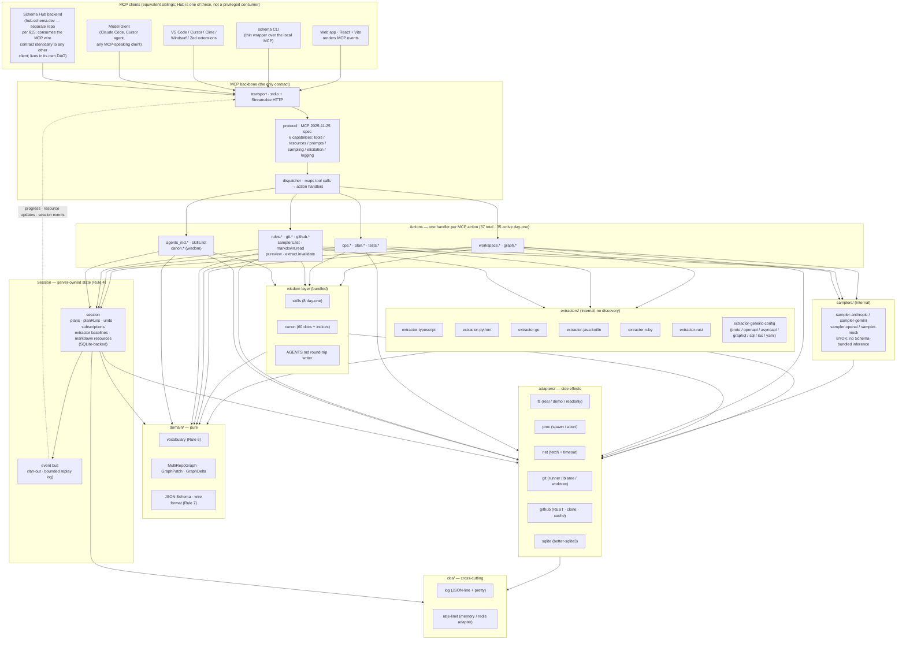

# Schema v3 — Architecture

> **Read [`../VISION.md`](../VISION.md) first.** This doc is the
> engineering spec; the vision is the product layer. The vision
> answers *what we're building, for whom, why*. This doc answers
> *how*. Read vision → architecture → research.
>
> **Status:** draft, awaiting user review. Binding once approved.
>
> **Inputs.** Fourteen binding research docs in `../research/` + the
> vocabulary kit at `../marketing/vocabulary-kit.md`. Every decision
> in §1–§13 cites at least one section of one input.
>
> **What this doc replaces.** The v2 architecture at
> `../inherited/schema-v2-architecture.md` and v2's 72-row deviations
> log. v3 inherits specific decisions from v2 (listed in §13.1);
> overturns others (§13.2); and is allowed to disagree with anything
> v2 said when the disagreement cites a research finding.
>
> **What this doc decides.** Everything required to start writing v3
> code, in order: hard rules, system overview, module DAG, data
> model, action surface, session model, plugin contract (internal-
> only), wire format, failure modes, non-goals, the v2 → v3 diff.
>
> **What this doc does NOT decide.** The v1 / v2 deletion timeline.
> The launch date. Year-2 monetisation. These belong to follow-up
> decisions the user owns.

---

## Citation key

Citation pattern: `[research:NN.§S.S]` where `NN` is the two-digit
research-doc number and `§S.S` is the section. The 14 research docs
are:

| # | Doc |
|---|---|
| 01 | `research/01-mvp-scope-and-technical-gap.md` (the v3 inherited mvp-scope) |
| 02 | `research/02-target-user-staff-plus.md` (the inherited target-user research) |
| 03 | `research/03-cross-language-bridges.md` |
| 04 | `research/04-wisdom-layer-empirics.md` |
| 05 | `research/05-distribution-and-gtm.md` |
| 06 | `research/06-extractor-typescript-implementation.md` |
| 07 | `research/07-extractor-python-implementation.md` |
| 08 | `research/08-extractor-go-implementation.md` |
| 09 | `research/09-extractor-java-kotlin-implementation.md` |
| 10 | `research/10-extractor-ruby-implementation.md` |
| 11 | `research/11-extractor-rust-implementation.md` |
| 12 | `research/12-extractor-generic-config-implementation.md` |
| 13 | `research/13-vocabulary-kit-refresh.md` |
| 14 | `research/14-runtime-and-completeness-audit.md` |

Plus `[user:N.N]` for the target-user research (a synonym for
`[research:02.§N.N]`) and `[vocab]` for the vocabulary kit. The two
"inherited" docs (01, 02) carried forward from v2's research and
are binding for v3.

---

## Table of contents

1. Hard rules
2. System overview
3. Module boundaries (the DAG)
4. Data model — the project graph
5. MCP action surface (the wire contract)
6. Round-trip data flow
7. Session + state management
8. Plug-and-play model (the v2 → v3 inversion)
9. Plugin contract (internal-only)
10. Wisdom layer
11. Runtime, distribution, build pipeline
12. Failure modes
13. Non-goals + the v2 → v3 diff
14. Implementation order
15. Business model + monetisation (Schema Hub + Enterprise)
16. References
17. Moat-building roadmap (post-v1)

---

## 1. Hard rules

Thirteen rules govern every v3 decision. The architecture is a
function of these rules + the research. They are not the cheapest
to enforce — they are the cheapest to *not* break later.

Of the thirteen, eight are inherited from `INHERITED-SUMMARY §8`
(Rules 1–4, 6, 9, 10, 13), three are net-new from this doc's
lint-enforceable patterns (Rule 5 DAG, Rule 7 Wire format, Rule 8
Markdown variant), and two are net-new from the runtime/
distribution audit per `[research:14.§6 item 1]` (Rule 11
Runtime, Rule 12 Distribution).

### Rule 1 · MCP is the contract

Anything not expressible as an MCP action, resource, or prompt is a
feature that does not exist in v3. The web app is an MCP client.
The VS Code extension is an MCP client. The CLI is an MCP client.
The model client is an MCP client. The contract between Schema and
*any* surface is MCP and only MCP.

**Why.** v1 + v2's two-channel problem: 14 HTTP `/api/*` routes were
the *real* API; the v2 `packages/schema-mcp/` was a parallel
Express-only surface that didn't reach them. Result: bug surface ×2
forever, recogniser parity unenforceable. [research:01.§4.5,
audit:L6]

**Enforcement.** Zero HTTP routes in v3 source that aren't a thin
wrapper over an MCP action. Architectural review (the §3 DAG)
forbids the surface from existing.

### Rule 2 · Cite the research

Every architectural decision in this doc references at least one
section of one binding research doc. Decisions not anchored to the
research are not in the doc. The architecture exists to be the
crystallisation of the research, not a second authority.

**Why.** v2 produced 72 deviations because the architecture made
calls the research hadn't supported, and the build then ran into
contradictions. v3 fixes this by requiring the chain
`research → architecture → code` at every step.
[research:14.§6, INHERITED-SUMMARY §8]

**Enforcement.** Every `## ` and `### ` heading in this doc cites at
least one `[research:NN.§S.S]` reference in its body. Sections
without citations are bugs.

### Rule 3 · Plug-and-play is binding

The user installs Schema and Schema works. No language toolchain
required. No plugin marketplace download. No `.schema/` config file
required at first boot. No annotation of the user's source. The
default install path is one command:

```
npx -y @schema-ai/mcp@latest
```

For Claude Desktop / Cursor / Cline / Windsurf / Zed: paste into
`mcp.json`. The MCP client spawns the server. The user opens a
workspace. The graph appears.

**Why.** v3's primary acquisition channel is the staff+ engineer on
a Monday morning who has 45 minutes between meetings to evaluate
Schema. Anything that requires a hosted account, a vendor review,
or a per-language toolchain install loses that engineer.
[research:05.§3.1, §6.3, §6.4]

**Enforcement.** Every architectural choice is evaluated against
"does this require the user to install anything beyond `schema`
itself?" If yes, the choice is wrong. Acceptable user actions on
the *first install*: paste a config snippet into one file, click
"Continue" once. That's it.

### Rule 4 · Server-owned execution state (R1.S, inherited)

All plan-execution, undo, extractor-baseline, rule-evaluation, and
session state lives in the MCP server keyed by an opaque
`sessionId`. Clients hold `sessionId + subscription`. Nothing else.
Wire requests carry the `sessionId` and the action arguments — never
timestamps, step indices, plan results, undo handles, or baselines.

**Why.** v1's god-object client store (~2,200 LOC of plan / extract /
undo / git context / fixture import) made it impossible for a model
client to drive Schema headlessly. The web app *was* the de-facto
runtime. v2 fixed this with R1.S, the spinal requirement, and
shipped a working multi-tab share-session proof in slice #2. v3
inherits this unchanged. [INHERITED-SUMMARY §5, audit:L7+L13+L14+L21+L25]

**Enforcement.** No public action signature carries client-clock
state. The session module is the *only* module that holds plan-
execution state (§3.3 in the DAG).

### Rule 5 · The DAG is real

§3's module dependency graph is acyclic. The boundary is enforced
by a lint rule reading `architecture/dag.json` at PR time. Forbidden
cycles surface as build failures, not review comments.

**Why.** v1 + v2's lessons L7 + L21 + L1 (god-object store, parallel
extractors, store-to-HTTP coupling) all trace to a missing or
unenforced module boundary. v2 shipped the DAG enforcement and it
worked. v3 inherits the pattern. [research:14.§2.1 row "Module
DAG", INHERITED-SUMMARY §8 rule 4]

**Enforcement.** ESLint rule `schema/dag` reads
`architecture/dag.json`; CI fails on cross-layer imports outside
the allowlist. Tooling lives at `tools/eslint-plugin-schema/`.

### Rule 6 · Vocabulary is single-source-of-truth

`NodeKind` and `EdgeRelation` exist as `const`-as-record exports
from exactly one file (`src/domain/vocabulary.ts`). String-literal
references to either anywhere else in the tree are forbidden. A
lint rule enforces this.

**Why.** v1 spread `"applies_middleware"` / `"registers_route"` /
`"calls"` / `"imports"` across 30+ files. Adding a relation
required editing every site. v2 R2 fixed it; v3 inherits.
[INHERITED-SUMMARY §5 + §8 rule 4, audit:L27]

**Enforcement.** ESLint rule `schema/no-vocabulary-string-literal`
forbids the literals outside the canonical file + 3 named
exceptions (the vocabulary file itself, the JSON Schema generator,
the vocabulary self-test). Tooling at `tools/eslint-plugin-schema/`.

### Rule 7 · Wire format is versioned

Every wire payload carries a `version: "1.0"` field. Major bumps
break; minor bumps add (new node kind / new edge relation / new
optional field). Schema validation rejects mismatches; the server
side surfaces incompatibility as `code: "wire-version-mismatch"`.

**Why.** v1's L8: ~200 unit tests pinned to fixture-specific node
ids made vocabulary evolution cascade through tests. v2 R3 added
versioning + golden-snapshot tests against the wire format's
*shape* (not its literal ids). v3 inherits.
[research:14.§3.3 I9, INHERITED-SUMMARY §5]

**Enforcement.** Wire schema generated from TS types at build
time; CI fails if the generated JSON Schema drifts from the source
of truth.

### Rule 8 · Every user-facing-data action emits a copy-ready markdown variant

Per Hard Rule §10 inherited from v2: actions whose output a staff+
engineer would *quote* in a PR comment, design doc, ADR, RFC, or
Slack message MUST emit a markdown rendering accessible at
`markdown://<action>/<resultId>` and fetchable via the
`markdown.read` action.

**Why.** The wedge per `[research:05.§4.4]` is the PR-comment
artifact. v3 ships when v3 ships, but it must ship as a tool that
*follows the user* to PR threads + ADRs + RFCs. The product is the
artifact, not the canvas. [research:02.§3.1, §3.3, §5.2 theme 1]

**Enforcement.** Canonical allowlist of 11 actions (§5.7).
`core/__tests__/actions.test.ts` asserts every allowlist entry
declares `markdownUri` in its output schema + every action
declaring `markdownUri` is on the allowlist. Drift fails CI.

### Rule 9 · Empty-extraction is a first-class case

The wire protocol distinguishes "extracting, results pending" from
"extraction done, found nothing." The session emits
`workspace.extraction_complete` even when the merged subgraph has
zero nodes. The GUI uses this to render "scan complete, no
contributions" rather than hanging in "Extracting structural
understanding…" forever.

**Why.** v2's D54 "empty-emission rule" plus the case study at
`../architecture/audits/case-study-empty-extraction-ux-gap.md`. The
server-side rule was correct (don't emit `graph.patched` with empty
patch — that's noise). The GUI-side absence of a "scan done"
signal was the bug. v3 closes the loop with an explicit event.
[`architecture/audits/case-study-empty-extraction-ux-gap.md` §5,
§7]

**Enforcement.** An e2e test for the empty-workspace case is in
the day-one test surface. The session module emits
`workspace.extraction_complete` regardless of whether
`graph.patched` fired.

### Rule 10 · No agnostic-violators in core

A choice that only works for one language, one framework, one
model vendor, one IDE, or one operating system is wrong. The
agnostic-core boundary is enforced by the DAG (the `core/` layers
have no language-specific code; all stack-specific cleverness lives
in `extractors/`).

**Why.** v1's classifier hard-coded Nest / Angular / TS dotted-
suffix tables; a Django repo classified every file as `utility`.
v2 fixed it by moving classification rules into the per-extractor
plugin. v3 inherits the principle; the architectural refinement
is that "plugin" is internal-only per Rule 3 (plug-and-play
constraint). [audit:L3, INHERITED-SUMMARY §5]

**Enforcement.** The DAG forbids `core/*` from importing any
`extractors/*`. The vocabulary lint rule forbids stack-specific
strings (`"requireAuth"`, `"protected"`) in `core/`.

### Rule 11 · Runtime is Node.js LTS (v22 → v24)

Schema's host runtime is Node.js LTS, shipped as part of the
binary. The decision is overdetermined by the parser-ecosystem
commitments in `[research:06–12]` (every per-language extractor
commits to JS-side parsers via N-API native bindings) and the
install-path commitment in `[research:05.§6.3]` (`npx -y
@schema-ai/mcp@latest` requires Node).

**Why.** `[research:14.§2.1]`'s 8-criterion stack evaluation passed
Node on all 8; Bun failed C1 (npx ecosystem) and C4 (NAPI risk
profile); Deno failed C1 (npm-install-path incompatible); Go and
Rust failed C5 (JS parser ecosystem unreachable without IPC
sidecars that defeat the cold-start budget). Per
`[research:14.§4.1 R1]` + `[research:14.§6 item 1]`: this is a
binding architectural axis, not a build-time preference.

**Enforcement.** Every per-language extractor is implemented in
TS/JS, calling into N-API native bindings for tree-sitter,
ast-grep, and the embedding model. CI rule
`tools/eslint-plugin-schema/runtime.js` fails if `package.json`'s
`engines.node` is outside `>=22 <25` or if any non-Node host
target appears in the build script.

### Rule 12 · Standalone binary via `@yao-pkg/pkg` v3.0; Node SEA v3.1

Day-one ships via `@yao-pkg/pkg` v6.x; revisits Node SEA in v3.1
once the assets API stabilises and the native-addon gap closes.

**Why.** As of May 2026, Node SEA's `--build-sea` is stable but
the `.node` assets API is still "active development." Schema
bundles 7 tree-sitter native parsers + `@ast-grep/napi`; SEA
cannot ship them in a single binary today. `@yao-pkg/pkg` ships
them via the `assets` field + `process.dlopen` shim. Per
`[research:14.§2.2]` + `[research:14.§4.2 R2]` + `[research:14.§6
item 1]`.

**Enforcement.** The release pipeline uses `@yao-pkg/pkg` for
GitHub Releases per-platform binaries; the `optionalDependencies`
pattern keeps the npm tarball platform-targeted (~25–45 MB
download). v3.1 swaps to SEA when the assets API ships. CI rule
`tools/eslint-plugin-schema/runtime.js` (same rule as Rule 11)
also fails on non-`@yao-pkg/pkg` build targets in v3.0.

### Rule 13 · No code commits until this doc is approved

Once approved, this doc is binding. Code commits to `Schemav3/src/`
that contradict it are returned for revision. Every code commit
cites the section it implements (`// Per architecture/schema-v3.md
§X.Y`), same convention as v2's `core/`. [research:14.§6,
INHERITED-SUMMARY §8 rule 7]

**Enforcement.** A pre-commit hook scans for the citation header on
new files in `Schemav3/src/`. CI fails on commits adding source
files without the citation.

---

## 2. System overview

### 2.1 The diagram

> Per Rule 1: every arrow into the agnostic core originates at the
> MCP transport. The web app, the CLI, the model client, and the
> VS Code extension are equivalent siblings — none is special.



### 2.2 Invariants from the diagram

Each enforces a hard rule:

- **MCP is the only path between any client and any utility.** Web
  app, CLI, model client, VS Code extension, **and Schema Hub
  backend** all hit the same `tools/call` dispatcher. Hub is not
  privileged — it consumes the OSS core's MCP surface identically
  to a Cursor user, ensuring the OSS surface stays the
  one-true-API. [Rule 1, research:01.§4.5, §15.5]
- **Plugins do not exist as a user-facing concept** — `extractors/`
  is an internal source-organisation tier with no discovery, no
  manifest published to users, no marketplace. The user installs
  Schema and gets all 7 extractors bundled. [Rule 3, research:14.§2.1]
- **Session events fan out to all subscribed clients simultaneously.**
  Two browser tabs against the same workspace URI receive the
  same logical sessionId and identical events.
  [research:01.§4.5 option A, INHERITED-SUMMARY §5 (v2 slice #2)]
- **`domain/` has zero outbound arrows** (pure types). `adapters/`
  have zero outbound arrows into business logic. [Rule 5]
- **Skills + canon ship in the binary** (no marketplace download).
  [Rule 3, research:04.§5]

### 2.3 The agnostic-core boundary

**Core contains, in source:** the MCP transport / protocol /
dispatcher, the session module, the action handlers, the seven
extractors (one per language stack), the samplers, the wisdom
layer, the side-effect adapters, the domain types + vocabulary,
plus `obs/` (logging, rate-limiting).

**Core does NOT contain:** any user-installed plugin code, any
language-specific code outside the extractors, any external service
SDK code, any third-party-vendor LLM client code (samplers are
internal modules; vendor selection is via session preference),
**any Schema Hub server code** (Hub lives in a separate repo at
`hub.schema.dev` per §15; Hub *consumes* the OSS core via the
MCP wire contract, same as any other client).

The "minimum agnostic surface" [research:01.§3.3] for v3 day-one:
**7 language extractors** (TS / JS, Python, Go, Java + Kotlin,
Ruby, Rust, generic-config covering proto / openapi / asyncapi /
graphql / sql / iac); **3 active cross-language bridges** with
spec-as-ground-truth (REST/OpenAPI, gRPC/Protobuf, SQL DDL +
ORM models — these emit `implements_contract` and
`consumes_contract` edges between spec and per-language source);
**plus the message-bus inference path** (Kafka/NATS/RabbitMQ/SQS
SDK call-shape recognisers, 70–85% precision without a spec) per
[research:03.§8.1, research:14.§3.3.2 row O6]. **3 additional
spec parsers ship day-one as recognisers** (AsyncAPI, GraphQL,
Helm/k8s YAML, HCL — they emit `contract:` nodes from spec files
day-one; the *bridge work* linking spec → per-language consumer
code lands v3.1) per [research:12.R3-R5, research:14.§4.6 R6
row 2]. Plus **4 samplers** (Anthropic, Gemini, OpenAI, mock),
**9 skills + 60-doc canon** per [research:04.R1-R3].

### 2.4 Target user (precision, inherited)

Per `[research:02.§1.2, §2.3]` + `[research:13.R1]`:

- **Primary cohort.** Staff+ engineer — Google L6 / Apple ICT5 /
  Microsoft L65 / Amazon Principal SDE / Stripe L4–L5. Median 8–12
  years experience. Codes 20% of week; reviews 25%; meets 22%;
  designs / sponsors 33%. Has install authority. Reaches v3 via
  PR-comment artifact + Pragmatic Engineer / lethain endorsements.
- **Secondary cohort.** Senior engineer (Google L5 / Apple ICT4).
  5–7 years experience. Reaches v3 through the canvas + diff
  overlay.
- **Tertiary cohort.** Principal / Senior Staff. Reaches v3 as a
  citation source in engineering-strategy docs.

Public-facing copy uses **"staff+ engineers"** or **"senior+
engineers"** — never "senior devs." [vocab §1, research:13.R1]

---

## 3. Module boundaries (the DAG)

### 3.1 Layer overview

Nine layers, topological order (bottom-of-DAG first). Each layer's
**responsibility** + **public surface** + **anti-responsibilities**
+ **allowed deps** below.

```
                          ┌── clients ──┐
                          │  (web · cli · ext · model)
                          │   wire only ↓
                          └──────┬──────┘
                                 │
                          ┌──── mcp/ ───────┐
                          │ transport + dispatcher
                          └──┬───────┬──────┘
                             │       │
                  actions/ ◄─┘       └─► session/
                  │     │                    │
       ┌──────────┘     │                    │
       │                │                    │
       ▼                ▼                    ▼
extractors/         domain/               domain/
samplers/           adapters/             adapters/
wisdom/             obs/                  obs/
       │
       ▼
   domain/ + adapters/ + obs/  (bottom)
```

The bottom of the DAG: `domain/`, `adapters/`, `obs/`. The top:
`clients/`. Each layer below details its surface.

### 3.2 `obs/` (cross-cutting, bottom of DAG)

**Responsibility.** Logging + rate-limiting. Node std lib only.

**Public surface.** `logger`, `newRequestId`, `timed(log, op,
attrs, fn)`, `rateLimiter(adapter)`, `rateLimitAdapters.{memory,
redis,upstash}`.

**Anti-responsibilities.** Does not know about graphs, plans, MCP,
or sessions. Does not call adapters. Does not throw.

**Allowed deps.** Node std only.

**Salvages from v2.** `src/server/log.ts` + `src/server/rateLimit.ts`
(both port forward unchanged). [research:14.§3.3 I9]

### 3.3 `domain/` (pure types + vocabulary)

**Responsibility.** Pure types. Single source of truth for
vocabulary. No I/O.

**Public surface.** `NodeKind`, `EdgeRelation`, `NODE_KINDS`,
`EDGE_RELATIONS` (const-as records, Rule 6), `MultiRepoGraph`,
`RepoSubgraph`, `GraphNode`, `GraphEdge`, `InterRepoEdge`, `Cluster`,
`GraphPatch`, `GraphDelta`, `Insight`, `Violation`, `Rule`, `Plan`,
`PlanRun`, `StepRun`, `WireFormatVersion`, the JSON Schema
generators, `applyPatch(graph, patch) → MultiRepoGraph`, `graphHash`,
`idFromLocator(locator)`.

**Anti-responsibilities.** Does not read disk. Does not call LLMs.
Does not depend on `ts-morph`, Express, Anthropic, Supabase, or any
external runtime. Does not contain demo / mock data.

**Allowed deps.** `obs/` only (for `timed` instrumentation in
`applyPatch`). No external deps.

**Salvages from v2.** `src/lib/aggregate.ts`, `src/lib/repoKey.ts`,
`src/lib/clusterColor.ts`, `src/lib/fuzzy.ts`, `src/lib/problems.ts`,
`src/server/ops/diffUtil.ts`. [research:14.§3.3, INHERITED-SUMMARY §5]

### 3.4 `adapters/` (side effects)

**Responsibility.** File system, child processes, network, git,
GitHub, SQLite. Each adapter is an interface with at least two
implementations: `real` and `demo`. Selection is per-session.

**Public surface.** `fsAdapter`, `procAdapter`, `netAdapter`,
`gitAdapter`, `githubAdapter`, `sqliteAdapter`. Each export
carries `adapterImpls: { real, demo, readonly? }`.

**Anti-responsibilities.** Does not know about graphs, plans, MCP,
or sessions. Does not call into business logic. Each adapter
function is pure side effect with a typed return.

**Allowed deps.** `domain/`, `obs/`. Plus Node std + the
`better-sqlite3` native binding [research:14.R8].

**Salvages from v2.** `src/server/extract/security.ts` (→ fs
`resolveAllowed`), `src/server/git/{runner,blame,gh}.ts`,
`src/server/github/{clone,repos,token}.ts`,
`src/server/ops/concurrencyGuard.ts` (→ fs `detectConcurrentEdit`).

### 3.5 `session/` (server-owned execution state)

**Responsibility.** Server-owned execution state per Rule 4. One
`Session` per active workspace per client. Holds plans, plan-runs,
undo records, extractor cache + baselines, subscription state,
sampler preferences, markdown resources.

**Public surface.**

```ts
openSession(workspaceUris: readonly string[], init?: SessionInit) → Session
Session.subscribe(filter?: SubscriptionFilter) → AsyncIterable<SessionEvent>
Session.dispatch(action: ActionName, args: ActionArgs) → ActionResult
closeSession(id: SessionId)
getSession(id: SessionId) → Session | null
```

Internal: `Session.cache` (extractor results, rule evaluations),
`Session.planRunStore`, `Session.undoStack`, `Session.markdownResources`.

**Anti-responsibilities.** Does not host action *logic* (in
`actions/`). Does not discover plugins (no discovery in v3 per
Rule 3). Does not serialise itself to the wire (the MCP layer
does that). Does not bypass adapters for I/O.

**Allowed deps.** `domain/`, `adapters/`, `obs/`.

**Salvages from v2.** `src/server/git/orchestrator.ts`
(`GitPlanContext` → `Session.gitContext`), `src/server/extract/
incremental.ts` (→ `Session.cache.incrementalReextract`),
`src/server/local-diff/index.ts` (→ `Session.localDiff()`),
`src/server/ops/restore.ts` (→ `Session.undo`).

**Storage** [research:14.R8]. SQLite via `better-sqlite3` for:
session metadata, extractor result cache (keyed on `(rootUri,
sha)`), rule-evaluation cache (keyed on `(graphHash, ruleSet)`),
plan run history. Flat files (gzipped JSON, content-addressed by
SHA) for: the prebuilt wisdom-layer canon indices, the wire-schema
JSON Schemas.

### 3.6 `extractors/` (internal, no discovery)

**Responsibility.** Seven language-stack-specific extractors. Each
emits a `RepoSubgraph` per repo for the languages it covers.
Discovery is internal-only: the dispatcher knows about the seven
extractors at compile time. No manifest. No `node_modules/@schema-
plugin-*/`. No `.schema/plugins/`.

**Public surface.** A `BundledExtractor` interface (internal;
full definition in §9.1):

```ts
interface BundledExtractor {
  readonly id: string;
  declare(): ExtractorCapability;                  // languages, frameworks, needsAdapters
  extract(ctx: ExtractContext) → AsyncIterable<ExtractEvent>;
}
```

The seven concrete instances ship in source. The action handlers
import them by name; the dispatcher routes based on the
`ExtractorCapability` returned from `declare()` (file extensions
+ framework recognition). [Rule 3, research:14.§3.3 T1]

**Anti-responsibilities.** Does not depend on `actions/`, `mcp/`,
`session/`. Does not call adapters except the ones declared in its
`ExtractorCapability` (the `needsAdapters` field). Plugins are
*callable*, even though they're bundled.

**Allowed deps.** `domain/`, `adapters/`, `obs/`. Plus per-extractor
external deps: `ts-morph` for TS [research:06.R1], tree-sitter
grammars for the others [research:07-11.R1], parser packages for
generic-config [research:12.R1].

**The seven extractors and their day-one frameworks:**

| Extractor | Day-one frameworks | Parser stack |
|---|---|---|
| `extractor-typescript` | Express, Hono, Fastify, Koa, Next.js App + Pages, NestJS, tRPC | tree-sitter-typescript + ts-morph on-demand [research:06.R1] |
| `extractor-python` | Django, FastAPI, Flask + Starlette, Sinatra-equivalents | tree-sitter-python [research:07.R1] |
| `extractor-go` | net/http, Gin, Echo, Chi, Fiber, Gorilla Mux, gRPC, Connect | tree-sitter-go + Schema-side semantic layer [research:08.R1] |
| `extractor-java-kotlin` | Spring Boot + Spring MVC, Spring WebFlux, Quarkus, Micronaut, Ktor, Helidon | tree-sitter-java + tree-sitter-kotlin [research:09.R1] |
| `extractor-ruby` | Rails, Sinatra, Sidekiq | tree-sitter-ruby + libprism opt-in [research:10.R1] |
| `extractor-rust` | Axum, Actix, Rocket, tonic, Loco | tree-sitter-rust + macro pattern-matching [research:11.R1] |
| `extractor-generic-config` | proto, openapi, asyncapi, graphql, sql, terraform, k8s yaml | per-format parsers [research:12.R1] |

### 3.7 `samplers/` (internal, BYOK)

**Responsibility.** LLM vendor adapters. Per [research:05.R6], v3
ships pure OSS with BYOK (bring-your-own-key) — no Schema-bundled
inference. Samplers are internal modules selected per session via
`session.samplerPrefs`.

**Public surface.**

```ts
interface BundledSampler {
  readonly id: string;
  readonly vendor: "anthropic" | "gemini" | "openai" | "mock";
  declare(): SamplerCapability;
  dispatch(ctx: SamplerContext) → AsyncIterable<SamplerEvent>;
}
```

**The four day-one samplers:**

| Sampler | When used | Key source |
|---|---|---|
| `sampler-anthropic` | Default for Anthropic users | `ANTHROPIC_API_KEY` env var or session-passed key |
| `sampler-gemini` | Google AI users | `GEMINI_API_KEY` / `GOOGLE_API_KEY` |
| `sampler-openai` | OpenAI users | `OPENAI_API_KEY` |
| `sampler-mock` | No-key fallback (graph-shape-derived heuristic, not keyword matching) | None [audit:L16, R16] |

**Anti-responsibilities.** Does not store keys server-side beyond
the session lifetime. Does not log keys. Does not call other
samplers.

**Key handling.** Keys are read from environment variables at
process spawn time (`ANTHROPIC_API_KEY`, `GEMINI_API_KEY`,
`OPENAI_API_KEY`); never round-tripped over the wire (per Rule 4
server-owned state); held in-memory in the session for the
session's lifetime; redacted in all logs (`obs/log` masks
`*_API_KEY` env values automatically). Per the MCP 2025-11-25
spec, elicitation form mode MUST NOT be used to collect API keys
[research:14.§2.3]; URL-mode elicitation is reserved for v3.x
out-of-band auth flows if/when v3 ships hosted features.

**First-run UX (no API keys set).** Default `samplerPrefs` is
`["anthropic", "gemini", "openai", "mock"]`. If no real-vendor
key is set, sampler-using actions transparently fall back to
`sampler-mock` (graph-shape-derived heuristic per audit:L16; not
keyword matching). The first such fallback emits a one-time
`info`-level log line naming the missing keys (e.g.
`"No ANTHROPIC_API_KEY / GEMINI_API_KEY / OPENAI_API_KEY in env;
using sampler-mock. Set one to enable real-LLM planning."`). The
`samplers.list` action (§5.3) returns each sampler's `available`
+ `reason` so the model client can surface the situation in
its own UX. Users who want to disable mock entirely override
`samplerPrefs` at `workspace.open` to omit `"mock"`; sampler-using
actions then return `vendor-unavailable` until a key is set.
[research:05.§7 + audit:L16, R16]

**Allowed deps.** `domain/`, `adapters/` (`net` only), `obs/`.

### 3.8 `wisdom/` (skills + canon + AGENTS.md)

**Responsibility.** The wisdom layer per `[research:04.R1-R6]`. Three
components:

1. **AGENTS.md round-trip writer.** The headline feature. Reads
   AGENTS.md / .cursor/rules / CLAUDE.md. Writes Schema-derived
   facts back. Promoted from "one of three peers" in v2 to "load-
   bearing piece" in v3.
2. **9 bundled skills** [research:04.R1]. 5 procedural cross-
   cutting (`refactor-handler-into-service`, `extract-package-
   from-monolith`, `add-cross-cutting-middleware`, `detect-
   architectural-drift`) + 4 paradigm-specific (`erlang-otp-
   supervision`, `cqrs-event-sourcing-rebuildability`, `clojure-
   concurrency-primitive-selection`, `jepsen-fault-class-reasoning`).
3. **60-doc canon + hybrid RAG indices.** OTP/BEAM (12), STM +
   functional concurrency (12), CQRS + Event Sourcing (12),
   distributed-systems failure modes / Jepsen (~24). Hybrid BM25
   (tantivy) + HNSW (USearch) + RRF. Pre-built indices ship in the
   binary. RAG over user code remains OUT.

**Public surface (dual: resources + tools).** Per the MCP
2025-11-25 spec semantic distinction (resources are
application-controlled passive context; tools are
model-controlled active operations) and per
`[research:04.§7.7 + §8 item 2]`, the wisdom layer ships **both**
surfaces:

- **MCP resources** for content the client surfaces verbatim:
  - Skills at `skill://<id>` URIs — for Claude Code's progressive
    disclosure (the model sees skill metadata in
    `available_skills` system-prompt; loads body via
    `resources/read` only when invoked) per `[research:04.§2.5]`.
  - Canon documents at `canon://<paradigm>/<id>#<chunk>` URIs —
    individual chunks readable via `resources/read` once the
    model has a URI from a `canon.search` hit.

- **MCP tools** for content the model needs to query, search,
  or write (resources are read-only by spec; queries with scoring
  + parameters are not URI templates):
  - `skills.list` (§5.3) — returns skill metadata for non-Claude
    clients (Cursor agent, Cline, headless model clients) that
    don't surface MCP resources to the model. The action returns
    the same metadata that `resources/list` returns for `skill://*`.
  - `canon.search` (§5.3) — hybrid BM25 (tantivy) + HNSW
    (USearch) + RRF retrieval; takes `(paradigm, query, k)`;
    cannot be expressed as a URI template.
  - `canon.read` (§5.3) — also exposed as a tool for clients that
    don't surface resources; same payload as `resources/read` for
    a `canon://` URI.
  - `agents_md.read` + `agents_md.write_facts` (§5.3) — active
    operations (computing facts from the live graph; writing
    files); MUST be tools per spec because resources are read-only.

The dual-surface pattern is established practice in production
MCP servers (per the spec docs + reference MCP server
implementations); resources optimise for application-driven
context loading, tools optimise for model-driven retrieval and
writes.

**Anti-responsibilities.** Does not call samplers directly. Does
not retrieve over user code. Does not download additional content
at runtime (everything ships in the binary).

**Allowed deps.** `domain/`, `adapters/` (fs only, for reading
the bundled canon directory), `obs/`. Plus the embedding ONNX
runtime (~80 MB) and the tantivy + USearch native bindings.

**Binary cost.** ~75 MB of the 250 MB binary budget [research:04.R4].

### 3.9 `actions/` (one handler per MCP action)

**Responsibility.** One typed handler per MCP action. The action
handler is where extractors are invoked, where samplers are
invoked, where session state is mutated through `Session.dispatch`.

**Public surface.**

```ts
const actionRegistry: Map<ActionName, ActionHandler> = new Map([...]);

interface ActionHandler<TArgs, TResult> {
  name: ActionName;
  inputSchema: JSONSchema7;
  outputSchema: JSONSchema7;
  sideEffect: "none" | "preflightable" | "final";
  handler: (session: Session | null, args: TArgs, ctx: ActionContext) → Promise<ActionResult<TResult>>;
}
```

The §5 surface is the canonical list (37 actions total; 35 active
day-one; `handoff.*` deferred to v3.1 per [research:14.R7 T2 +
research:02.§4.4 F3]).

**Anti-responsibilities.** Does not touch the transport (the `mcp/`
layer does). Does not keep state across calls (the session does).
Does not speak directly to a vendor (samplers are internal modules
invoked via `samplers.dispatch`).

**Allowed deps.** `session/`, `extractors/`, `samplers/`, `wisdom/`,
`domain/`, `adapters/`, `obs/`. Not `mcp/` — MCP calls into
actions, never the other way.

### 3.10 `mcp/` (the wire format)

**Responsibility.** Wire-format implementation of MCP 2025-11-25.
Transport (stdio + Streamable HTTP), protocol (initialize, tools/
list, tools/call, resources/list, resources/read, prompts/list,
sampling, elicitation, progress notifications, logging), dispatch
into action handlers.

**Public surface.**

```ts
runMcpStdio(opts: McpServerOpts): Promise<void>
mountMcpHttp(app: HttpApp, opts: McpServerOpts): void
buildMcpHandler(opts: { session, actions, resources, prompts }): McpHandler
```

**Capabilities declared in `initialize` reply (per Rule 1 + v2 D37):**
six top-level keys: `tools`, `resources`, `prompts`, `sampling`,
`elicitation`, `logging`. Progress Notifications ride per-request
via `_meta.progressToken` (per MCP spec; not a separate capability).

**Anti-responsibilities.** Does not know what any action does.
Does not keep execution state. Does not depend on extractors,
samplers, or wisdom.

**Allowed deps.** `actions/`, `session/`, `domain/`, `obs/`.

**Salvages from v2.** `packages/schema-mcp/src/transport.ts` +
`packages/schema-mcp/src/protocol.ts` (both port forward almost
unchanged); v2's Streamable HTTP transport from
`core/mcp/transport-http.ts` ports forward unchanged. [research:14.§3.3]

### 3.11 `clients/` (MCP clients, top of DAG)

**Responsibility.** Every front-end surface. Each is an MCP client
that opens a session and subscribes to events. Per Rule 1: clients
talk to `mcp/` over the wire (stdio or HTTP), NOT via source
import.

**Day-one client list** [research:05.R5]:

| Client | Purpose | Day-one status |
|---|---|---|
| `clients/cli` | The `schema` CLI for direct use + scripting | Day-one |
| `clients/web` | React + Vite web app, browser MCP client over Streamable HTTP | Day-one |
| `clients/vscode` | VS Code / Cursor extension | Day-one |

**Anti-responsibilities.** Does not contain plan-execution logic
(Rule 4). Does not call business logic directly — only through MCP.
Does not import bundled fixtures.

**Allowed deps.** Outbound only to `mcp/` over the wire (no source
import). Within a client: presentation framework + a thin MCP
client. Per [research:14.§3.3 I1]: GUI source imports are blocked
by the DAG (`gui → core` is forbidden); the wire is the only
crossing.

### 3.12 The DAG (forbidden cycles)

```
Allowed edges (read "A may import from B"):

domain        → obs
adapters      → domain, obs
session       → domain, adapters, obs
extractors    → domain, adapters, obs
samplers      → domain, adapters, obs
wisdom        → domain, adapters, obs
actions       → session, extractors, samplers, wisdom, domain, adapters, obs
mcp           → actions, session, domain, obs
clients       → (wire only — no source import allowed)
```

**Forbidden cycles** (the lint rule's named errors):

- `mcp ↛ clients` — clients are MCP clients over the wire
- `actions ↛ mcp` — MCP calls into actions, never reverse
- `session ↛ actions` — session holds state; actions mutate via Session.dispatch
- `extractors ↛ session` — extractors don't own state
- `samplers ↛ session` — same
- `wisdom ↛ session` — same
- `domain ↛ anything` — domain is pure
- `adapters ↛ anything in core` — adapters are leaves
- `obs ↛ anything` — obs is the bottom

Enforced by `tools/eslint-plugin-schema/dag.js` reading
`architecture/dag.json`. CI fails on violation. The data file is
the source of truth; the rule contains zero hardcoded layer order.

---

## 4. Data model — the project graph

### 4.1 Vocabulary (Rule 6)

```ts
// src/domain/vocabulary.ts — the ONLY place these literals exist.

export const NODE_KINDS = {
  // Code symbols (v1 carryover; battle-tested)
  route_handler:  "route_handler",
  service:        "service",
  data_access:    "data_access",
  middleware:     "middleware",
  model:          "model",
  utility:        "utility",
  external:       "external",

  // Cross-language bridges [research:01.§2.3, research:03.§2]
  contract:       "contract",     // openapi op · proto svc · graphql resolver · sql table · topic
  deployment:     "deployment",   // k8s service · lambda · terraform resource · helm chart
} as const;
export type NodeKind = keyof typeof NODE_KINDS;

export const EDGE_RELATIONS = {
  imports:                "imports",
  calls:                  "calls",
  registers_route:        "registers_route",
  applies_middleware:     "applies_middleware",

  implements_contract:    "implements_contract",   // handler ↔ openapi op · server ↔ proto svc
  consumes_contract:      "consumes_contract",     // client ↔ openapi op · producer ↔ topic
  deploys_to:             "deploys_to",            // service ↔ deployment
} as const;
export type EdgeRelation = keyof typeof EDGE_RELATIONS;
```

The ESLint rule `schema/no-vocabulary-string-literal` blocks string-
literal use outside this file + the three named exceptions
(vocabulary file itself, JSON Schema generator, vocabulary self-test).
[Rule 6, research:14.§3.3 D23]

### 4.2 Graph structure (the canonical container)

Per v2's D17 (inherited): there is ONE container shape —
`MultiRepoGraph` — with `repos.length === 1` for single-repo and
`length === N` for multi-repo. Inter-repo edges live at the TOP
level, not inside any single `RepoSubgraph`.

```ts
// src/domain/multi-repo.ts

export interface MultiRepoGraph {
  readonly version: WireFormatVersion;          // Rule 7
  readonly repos: readonly RepoSubgraph[];
  readonly interRepoEdges: readonly InterRepoEdge[];
  readonly vocabularyExtensions?: VocabularyExtensions;
}

export interface RepoSubgraph {
  readonly uri: string;                          // file:///abs/path | git://owner/repo@sha
  readonly nodes: readonly GraphNode[];
  readonly edges: readonly GraphEdge[];          // intra-repo only
  readonly clusters: readonly Cluster[];
}

export interface InterRepoEdge {
  readonly id: string;
  readonly source: string;
  readonly target: string;
  readonly sourceRepoUri: string;
  readonly targetRepoUri: string;
  readonly relation: EdgeRelation | string;
  readonly meta?: Readonly<Record<string, unknown>>;
}
```

**Single-repo case.** `MultiRepoGraph` with `repos.length === 1` +
`interRepoEdges.length === 0`. No special path; consumers handle
the multi case unconditionally. Per v2 D17: the alternative (a sum
type `Graph | MultiRepoGraph`) would produce ~30 sites of
conditional branching across action handlers, GUI consumers, and
the rule engine. The set form removes that.

### 4.3 Node id derivation (v2 D18 inherited)

`GraphNode.id` is derived from the node's locator via FNV-1a 64-bit
hash:

```ts
// src/domain/locator.ts

export function idFromLocator(loc: Locator): string {
  return `${loc.kind}:${fnv1a64Hex(loc.raw)}`;
}
```

Where `<kind>` is the locator's URI scheme (`file`, `git`, `proto`,
`openapi`, `topic`, `iac`, `graphql`, `sql`, `asyncapi`) and the
hash is FNV-1a 64-bit over the full locator string. Two nodes with
the same locator have the same id; a single-line move produces a
different id; the hash gives globally-unique stability across
repos.

### 4.4 Locator URI scheme

| Scheme | Shape | Used for |
|---|---|---|
| `file://` | `file:///abs/path#L<start>-L<end>` | Local extracted code |
| `git://`  | `git://owner/repo@<sha>:<relpath>#L<start>-L<end>` | GitHub / cached clones |
| `proto://` | `proto://<package>/<service>/<method>` | gRPC services [research:12.R5] |
| `openapi://` | `openapi://<doc-id>#<operation-id>` | OpenAPI operations |
| `asyncapi://` | `asyncapi://<doc-id>#<channel>` | AsyncAPI message channels [research:12.R2] |
| `graphql://` | `graphql://<schema-id>#<type>.<field>` | GraphQL operations [research:12.R5] |
| `sql://` | `sql://<schema-id>#<table>.<column>?` | SQL DDL tables [research:12.R3] |
| `topic://` | `topic://<broker>/<name>` | Kafka / NATS / SQS / etc. |
| `iac://` | `iac://<provider>/<resource>/<id>` | Terraform, k8s manifests [research:12.R4] |

### 4.5 GraphPatch — atomic mutations

```ts
export interface GraphPatch {
  addNodes?:     GraphNode[];
  removeNodeIds?: string[];
  addEdges?:     GraphEdge[];
  removeEdgeIds?: string[];
  addClusters?:    Cluster[];
  removeClusterIds?: string[];
  patchClusters?:  { id: string; addNodeIds?: string[]; removeNodeIds?: string[]; rename?: string }[];
  // Multi-repo:
  addInterRepoEdges?: InterRepoEdge[];
  removeInterRepoEdgeIds?: string[];
}
```

Atomic. `applyPatch(graph, patch) → MultiRepoGraph` throws on
precondition failure (e.g., `removeNodeIds` referencing an absent
id); caller sees unchanged graph. The session records the patch +
resulting `graphHash`. Subscribers fast-forward via the bounded
event-log replay (inherited from v2 D61).

### 4.6 Wire format version (Rule 7)

```ts
export type WireFormatVersion = `${number}.${number}`;
export const CURRENT_WIRE_VERSION: WireFormatVersion = "1.0";
```

**Versioning policy.** Major bump = breaking. Minor bump = additive
(new node kind / new edge relation / new optional field). Patch
versions don't appear in the wire format.

**Compatibility table.**

| MCP server speaks | Wire version in payload | Outcome |
|---|---|---|
| 1.x | 1.x (same or older minor) | Accept; validate against the payload's declared minor |
| 1.x | 1.y (newer minor) | Accept with warning; mark unknown fields in `vocabularyExtensions` |
| 1.x | 2.x | Reject with `code: "wire-version-mismatch"` |
| 1.x | absent | Reject with `code: "invalid-args"` |

JSON Schema for the wire is generated from the TS types at build
time; CI fails on drift between the generated schema + source of
truth.

### 4.7 GraphDelta (computed via diff)

```ts
export interface GraphDelta {
  nodes: { id: string; status: "added" | "removed" | "modified" | "unchanged"; reasons?: string[] }[];
  edges: { id: string; source: string; target: string; relation: string; status: "added" | "removed" | "unchanged" }[];
  interRepoEdges: { id: string; status: "added" | "removed" | "unchanged" }[];
  counts: { nodesAdded: number; nodesRemoved: number; nodesModified: number; edgesAdded: number; edgesRemoved: number };
}
```

Computed by `domain.computeDelta(base, head)`. Used by
`graph.diff_against`, `pr.review`, the local-diff overlay.

---

## 5. MCP action surface (the wire contract)

### 5.1 Action surface summary

**40 actions in 16 namespaces** [research:14.§3.1.3 gap #8 +
research:04.§8 item 2]. v3.0 ships **38 active actions across
15 namespaces** day-one (workspace, graph, rules, ops, plan,
tests, git, github, samplers, markdown, extract, pr, agents_md,
skills, canon); the `handoff.*` namespace (2 actions) is
deferred to v3.1 per the staff+ research's lower priority
`[research:02.§4.4 F3]` and the binary-size budget
`[research:14.§3.1.3]`.

**Amendment 2026-05-12:** 3 actions added beyond the original 35
for Schema Studio's Monaco editor: `workspace.list_files`,
`workspace.read_file`, `workspace.write_file`. See
`architecture/v1-readiness.md §1.1` for the full enumeration.

Per Rule 1 + Rule 4: every action takes `(sessionId, args)` —
except `workspace.open`, the one action that creates a session
[v2 D42 inherited].

### 5.2 The universal action shape

```ts
type ActionResult<T> =
  | { ok: true; data: T; eventsAppended?: SessionEventId[] }
  | { ok: false; code: ActionErrorCode; message: string; data?: unknown };

type ActionErrorCode =
  | "session-not-found"
  | "session-closed"
  | "invalid-args"
  | "wire-version-mismatch"            // Rule 7
  | "concurrent-edit"
  | "blocker"                          // op-defined precondition failed
  | "no-extractor-matched"             // no day-one extractor matched
  | "vendor-unavailable"               // sampler vendor refused / timed out
  | "rate-limited"
  | "io-error"
  | "adapter-mode-mismatch"            // v2 D19 inherited
  | "already-applied"                  // v2 D19 inherited
  | "internal";

type SideEffect = "none" | "preflightable" | "final";
```

**Wire envelope** (per v2 D41). The MCP `tools/call` content
envelope's `text` is the JSON-serialised `ActionResult`. Errors
travel as `isError: true` content per the MCP spec, NOT as
JSON-RPC errors.

### 5.3 The 35 day-one actions (active)

#### `workspace.*` (3)

```yaml
1. workspace.open
   side-effect: final
   in:  { uris: string[],                   # length-1 single, length-N multi (v2 D5)
          samplerPrefs?: string[],          # ["anthropic", "gemini", "openai", "mock"]
          adapterMode?: "real" | "demo" | "readonly"  # default "real"
        }
   out: { sessionId, workspace: WorkspaceDescribeResult }
   emits: workspace.opened
   # The one action that doesn't require a pre-existing session (v2 D42).

2. workspace.describe
   side-effect: none
   in:  { sessionId }
   out: WorkspaceDescribeResult {
          rootUris: string[],
          languages: string[],
          frameworks: string[],
          buildSystem: string | null,
          monorepo: boolean,
          extractors: { id, version, languages, frameworks-detected }[],
          samplers: { id, vendor, available, reason? }[],
          wireFormatVersion: WireFormatVersion,
          schemaVersion: string,
          extractorBaseline: { extractedAt: number, hash: string },
          testRunners: { kind, command, cwd }[],
        }

3. workspace.close
   side-effect: final
   in:  { sessionId }
   out: { closed: boolean }
   emits: workspace.closed
```

#### `graph.*` (8)

```yaml
4. graph.summary
   side-effect: none
   in:  { sessionId, level?: "architecture" | "modules" | "detail" = "architecture" }
   out: { clusters: { id, name, size, kindMix, externalEdges }[], totalNodes, totalEdges, markdownUri }

5. graph.list_nodes
   side-effect: none
   in:  { sessionId,
          filter: { kind?: NodeKind[], cluster?: string[],
                    locatorPrefix?: string, namePattern?: string,
                    metaWhere?: { key: string, equals: unknown }[] },
          limit?: number = 100, cursor?: string }
   out: { nodes: GraphNode[], nextCursor?: string }

6. graph.get_node
   side-effect: none
   in:  { sessionId, id, include?: ("source" | "snippet" | "blame")[] }
   out: { node, source?, snippet?, blame? }

7. graph.find_callers
   side-effect: none
   in:  { sessionId, symbolId, depth?: number = 1 }
   out: { callers: { id, viaEdge, locator }[], truncated }

8. graph.find_callees
   side-effect: none
   in:  { sessionId, symbolId, depth?: number = 1 }
   out: { callees: { id, viaEdge, locator }[], truncated }

9. graph.path
   side-effect: none
   in:  { sessionId, from, to, maxHops?: number = 6 }
   out: { paths: GraphNode[][], allEdgesByPath: GraphEdge[][] }

10. graph.search
    side-effect: none
    in:  { sessionId, query, scope?: "name" | "file" | "all" = "all", limit?: number = 30 }
    out: { hits: { id, score, why }[] }

11. graph.diff_against
    side-effect: none
    in:  { sessionId, ref, includeFileStats?: boolean = true }
    out: { graphDelta, fileStats?, ruleDelta, markdownUri }

12. graph.summarize
    side-effect: none
    in:  { sessionId, scope?: "all" | { cluster: string } }
    out: { summary: string, edgeStats, clusterStats, topSmells: Insight[], markdownUri }
```

#### `rules.*` (4)

```yaml
13. rules.list
    side-effect: none
    in:  { sessionId }
    out: { rules: Rule[], imported: ImportedRule[], builtins: Rule[], markdownUri }

14. rules.evaluate
    side-effect: none
    in:  { sessionId,
           scope?: "all" | { cluster: string } | { node: string },
           llm?: boolean = false }     # opt-in per [research:02.§4.5, research:04.R6]
    out: { violations: Violation[],
           llmEvaluated?: { ruleId, ok, reason? }[],
           markdownUri }

15. rules.add
    side-effect: final
    in:  { sessionId, rule: { kind, body, severity?, evaluation?, globs? } }
    out: { id, persistedTo: "session" | "config", evaluation: { violations } }
    emits: rules.added

16. rules.export
    side-effect: final
    in:  { sessionId, target: "schema.config.json" }   # AGENTS.md write moved to agents_md.write_facts (action 31)
    out: { writtenPath, summary }
    emits: rules.exported
```

#### `ops.*` (2)

```yaml
17. ops.list
    side-effect: none
    in:  { sessionId, symbolId? }
    out: { ops: { id, name, description, applicableToKind: NodeKind[] }[] }

18. ops.preview
    side-effect: preflightable
    in:  { sessionId, symbolId, op, args? }
    out: { diff: UnifiedDiff, projectedGraphPatch, predictedRuleDelta, blockers: { code, message }[], markdownUri }
```

#### `plan.*` (5)

```yaml
19. plan.propose
    side-effect: preflightable
    in:  { sessionId, rationale, steps: PlanStep[] }
    out: { planId, projectedGraphPatch, predictedRuleDelta, projectedTestImpact, markdownUri }

20. plan.apply
    side-effect: final
    in:  { sessionId, planId, runTests?: boolean = true }
    out: { applied: boolean, planRunId }
    emits: plan.step.* (per step) · plan.completed | plan.failed

21. plan.restore
    side-effect: final
    in:  { sessionId, planRunId? }    # default = most recent
    out: { restored, fileCount, branchDeleted? }
    emits: plan.restored

22. plan.cancel
    side-effect: final
    in:  { sessionId, planRunId }
    out: { cancelled }
    emits: plan.cancelled

23. plan.status
    side-effect: none
    in:  { sessionId, planRunId }
    out: { state, steps: PlanStepStatus[], filesChanged, gitContext?, markdownUri }
```

#### `tests.*` (1)

```yaml
24. tests.run
    side-effect: final
    in:  { sessionId, target?: string, timeoutMs?: number = 600000 }
    out: { passed, failed, durations, log }
    emits: tests.progress (streamed log lines via Progress Notifications)
```

#### `git.*` + `github.*` (2)

```yaml
25. git.status
    side-effect: none
    in:  { sessionId }
    out: { branch, ahead, behind, dirty, untracked: string[] }

26. github.open_pr
    side-effect: final
    in:  { sessionId, title, body, base?: string = "main" }
    out: { url, number }
    emits: github.pr_opened
```

#### `samplers.*` (1)

```yaml
27. samplers.list
    side-effect: none
    in:  { sessionId }
    out: { samplers: { id, vendor, model, available: boolean, reason? }[] }
```

#### `markdown.*` (1, per Rule 8)

```yaml
28. markdown.read
    side-effect: none
    in:  { sessionId, uri: string }     # markdown://<action>/<resultId>
    out: { markdown: string, charset: "utf-8" }
```

#### `extract.*` (1)

```yaml
29. extract.invalidate
    side-effect: final
    in:  { sessionId, touchedUris: string[] }
    out: { invalidated: number }
    emits: extractor.invalidated
```

#### `pr.*` (1)

```yaml
30. pr.review
    side-effect: none
    in:  { sessionId, base?: string = "merge-base origin/main" }
    out: { graphDelta, baseEvalViolations, headEvalViolations, fileStats, markdownUri }
```

#### `agents_md.*` (2, per [research:04.§7.6 + §8 item 2])

```yaml
31. agents_md.read
    side-effect: none
    in:  { sessionId, includeUserSection?: boolean = false }
    out: { writtenPath: string,
           fenceId: string,                       # the <!-- schema:facts:start --> marker id
           schemaSection: string,                 # the Schema-fenced facts (rendered markdown)
           userSection?: string,                  # the rest of AGENTS.md (only if includeUserSection)
           markdownUri }

32. agents_md.write_facts
    side-effect: final
    in:  { sessionId, target?: string = "AGENTS.md" }   # path relative to workspace root
    out: { writtenPath: string, charsAdded: number, charsRemoved: number, fenceId: string }
    emits: agents_md.facts_written
    # The headline wisdom-layer feature [research:04.§7.6]. Idempotent;
    # respects the <!-- schema:facts:start ... end --> fence; user-edited
    # text outside the fence is never touched.
```

#### `skills.*` (1, per [research:04.§7.7 #3 + §8 item 2])

```yaml
33. skills.list
    side-effect: none
    in:  { sessionId }
    out: { skills: { id, type: "procedural" | "paradigm",
                     title, description,
                     uri: "skill://<id>" }[] }
    # Same metadata `resources/list` returns for `skill://*` URIs;
    # this action exists for non-Claude clients (Cursor agent, Cline,
    # headless model clients) that don't surface MCP resources to
    # the model. Per [research:04.§2.5].
```

#### `canon.*` (2, per [research:04.§7.3 + §8 item 2])

```yaml
34. canon.search
    side-effect: none
    in:  { sessionId,
           paradigm: "otp" | "stm" | "cqrs" | "distsys",
           query: string,
           k?: number = 8 }
    out: { hits: { uri: "canon://<paradigm>/<id>#<chunk>",
                   score, snippet, title, sourceUrl, license }[] }
    # Hybrid retrieval: BM25 (tantivy) + HNSW (USearch) + RRF.
    # Cannot be expressed as a URI template; MUST be a tool.

35. canon.read
    side-effect: none
    in:  { sessionId, uri: string }                # canon://<paradigm>/<id>#<chunk>
    out: { body: string,
           metadata: { title, author, license, sourceUrl } }
    # Also exposed as resource via `resources/read` for Claude Code's
    # progressive disclosure path; the action form is for clients that
    # don't surface resources to the model.
```

### 5.4 The 2 deferred actions (v3.1)

```yaml
36. handoff.export                                # v3.1
    side-effect: final
    in:  { sessionId, include?: ("graph" | "rules" | "plans" | "adrs" | "violations" | "agents-md")[] }
    out: { bundleId, sizeBytes, summary, markdownUri }
    emits: handoff.exported

37. handoff.import
    side-effect: final
    in:  { sessionId, bundleUri }
    out: { applied, summary }
    emits: handoff.imported
```

Deferred per [research:14.§3.1.3 T2]: the staff+ research ranks
handoff bundling 5th of 5 top priorities; v3.1 adds them once the
v3.0 surface is shipped + validated.

### 5.5 Streaming contract

Long-running actions emit MCP **Progress Notifications** keyed on
the client's `_meta.progressToken`. Per [research:14.§3.1.3 D8]:

| Action | Progress shape | Cadence |
|---|---|---|
| `workspace.open` | `{ stage: "discovering" \| "parsing" \| "linking" \| "classifying", filesDone, filesTotal }` | Every 100ms or 50 files, whichever rarer |
| `tests.run` | `{ stage, logChunk?, lineCount? }` | Per stdout line, debounced 100ms |
| `plan.apply` | `{ step, totalSteps, phase: "applying" \| "testing" \| "verifying" \| "passed" \| "failed", filesChanged?, diff? }` | One per phase transition; per-line during testing |
| `graph.diff_against` (when fetching) | `{ stage: "fetching" \| "extracting-base" \| "extracting-head" \| "computing-delta" }` | One per stage |
| `graph.summarize` (large) | `{ stage: "scanning" \| "summarising", clusterCount? }` | One per cluster |

**Subscription model.** Clients subscribe to a session's events via
`mcp.session.subscribe(filter)` returning an async iterable of typed
`SessionEvent`s. The fan-out bus pushes the same event to every
subscriber, so the web app + model client see identical state.
[v2 D32 inherited]

```ts
type SessionEvent =
  | { kind: "workspace.opened" | "workspace.closed", at: number }
  | { kind: "graph.patched", patch: GraphPatch, hash: string, at: number }
  | { kind: "workspace.extraction_complete", repoUri: string, contributedNodes: number, at: number }   // Rule 9
  | { kind: "rules.added" | "rules.exported", ruleId?: string, at: number }
  | { kind: "plan.proposed", planId: string, rationale: string, at: number }
  | { kind: "plan.step", planRunId: string, step: number, phase: string, at: number }
  | { kind: "plan.completed" | "plan.failed" | "plan.cancelled" | "plan.restored", planRunId: string, at: number }
  | { kind: "tests.progress", logChunk: string, at: number }
  | { kind: "github.pr_opened", url: string, number: number, at: number }
  | { kind: "violations.changed", added: Violation[], removed: Violation[], at: number }
  | { kind: "extractor.invalidated", touchedUris: string[], at: number }
  | { kind: "agents_md.facts_written", writtenPath: string, charsAdded: number, charsRemoved: number, at: number };
```

### 5.6 Elicitation

Server → client structured input mid-action per
[research:01.§4.1, §4.5]:

- **`plan.apply` on a dirty tree.** Elicit
  `{ choice: "stash" | "proceed-without-git" | "abort" }`.
- **`workspace.open` on an unrecognised stack.** Elicit
  `{ choice: "load-anyway" | "cancel" }` after listing the absent
  extractors.

Other actions complete without elicitation; the model client
doesn't have to support it for the basic flow.

### 5.7 Markdown variant allowlist (Rule 8)

11 actions emit a copy-ready markdown variant per Hard Rule §10's
inclusion principle ("would a staff+ engineer quote this in a PR
comment, ADR, or RFC?") [research:02.§3.3, research:05.§4.2]:

| Action | Reason on the allowlist |
|---|---|
| `graph.summary` | Cluster map + counts; pasted into onboarding docs + architecture summaries |
| `graph.summarize` | RFC-ready architectural summary |
| `graph.diff_against` | Local-vs-remote diff overlay's markdown comment; reference impl for Rule 8 |
| `rules.list` | Active rule set; pasted into ADRs |
| `rules.evaluate` | Violation list; pasted into PR comments to explain risk |
| `ops.preview` | Op preview before apply; pasted into PR descriptions |
| `plan.propose` | Plan rationale + steps; pasted into PR descriptions + design docs |
| `plan.status` | Per-step run report; pasted into incident docs + post-mortems |
| `pr.review` | The markdown comment IS what gets posted to the PR thread |
| `agents_md.read` | Per [research:04.§7.6] the headline wisdom feature; the rendered Schema-fenced AGENTS.md section is a copy-ready ADR fragment |
| `handoff.export` (v3.1) | Handoff bundle's overview rendering |

The 24 NOT on the list (navigation, side-effect, already-markdown,
operational): `graph.list_nodes`, `graph.get_node`,
`graph.find_callers`, `graph.find_callees`, `graph.path`,
`graph.search`, `ops.list`, `git.status`, `workspace.open`,
`workspace.close`, `tests.run`, `plan.apply`, `github.open_pr`,
`markdown.read`, `workspace.describe`, `samplers.list`,
`extract.invalidate`, `rules.add`, `rules.export`, `plan.restore`,
`plan.cancel`, `agents_md.write_facts` (writes the file directly;
no markdown-variant payload), `skills.list` (metadata-only;
machine-shaped), `canon.search` (machine-shaped result list with
URIs the model traverses), `canon.read` (returns the raw canon
chunk; already markdown), `handoff.import` (v3.1).

`__tests__/actions.test.ts` asserts the lists stay in sync. Drift
fails CI.

---

## 6. Round-trip data flow

Concrete polyglot example from [research:01.§4.4]: *"Add a request-
ID middleware to every public route, propagate it into Kafka
producer headers."* TypeScript frontend, Node Express services,
Python FastAPI service, Go Kafka producer.

### 6.1 The trace

1. **User** in the web app types the rationale + clicks Send.
2. **Web app** → MCP: `tools/call plan.propose { sessionId,
   rationale, steps: [] }`. Empty steps → the server prompts the
   model. Web app subscribes to `events:plan.*`.
3. **`mcp/dispatcher`** routes to `actions/plan-propose`.
4. **Action handler** calls `samplers.dispatch({ task: "plan",
   system: PLAN_SYSTEM_PROMPT, user: rationale })`. The system
   prompt is NOT enumerating ops (Rule 4 inherited); it points the
   model at `tools/list` + `resources/list`.
5. **`samplers/dispatch`** picks the highest-priority available
   sampler from `session.samplerPrefs`. Routes to `sampler-anthropic`
   with timeout.
6. **M-think.** Model reads back the prompt. Decides "I need the
   project graph first." Issues `tools/call graph.summary`.
7. **MCP server → action `graph.summary`.** Returns a one-screen
   cluster summary: `frontend (TS) · api-server (Node/Express) ·
   ledger-service (Python/FastAPI) · indexer-service (Go) ·
   message-bus (Kafka)`. No state mutation. No event.
8. **M-think.** "Find HTTP routes." Calls `graph.list_nodes({
   filter: { kind: ["route_handler"] } })`.
9. **MCP → `graph.list_nodes`.** Returns 47 routes across 3
   services (Express + FastAPI). The FastAPI ones come from
   `extractor-python`'s recogniser.
10. **M-think.** "Find Kafka producer call-sites." Calls
    `graph.search({ query: "kafka", scope: "all" })`.
11. **MCP → `graph.search`.** Returns 3 producer constructors
    (1 in Go via `extractor-go`'s gRPC + Connect-go recogniser,
    2 in Node + Python).
12. **M-think.** "I need the proto for the bridge." Calls
    `graph.get_node({ id: "contract:proto:events.PageView/Publish",
    include: ["source"] })`.
13. **MCP → `graph.get_node`.** Returns the proto operation +
    snippet. Locator `proto://events.PageView/Publish`.
    [research:12.R5]
14. **M-think.** "Compose the plan." Issues `tools/call plan.propose
    { sessionId, rationale, steps: [...] }` with 47 + 3 = 50 steps.
15. **`actions/plan-propose`** validates each step's op exists in
    `actions/ops-*` (the bundled op set; not user-installable per
    Rule 3). Runs each op's `preview()` (no disk writes). Aggregates
    projected `GraphPatch` + predicted `ruleDelta`. Returns
    `{ planId, ... }`. Mutates `session.plans[planId]`. Emits
    `plan.proposed`. Web app shows the plan in the Plan Panel.
16. **Web app** receives `plan.proposed`. Renders the 50-step plan.
    User clicks Approve.
17. **Web app** → MCP: `plan.apply({ sessionId, planId, runTests:
    true })`. Subscribes to `tests.progress` + `plan.step.*`.
18. **`actions/plan-apply`** opens a `PlanRun` in the session
    (R13 from v2). Initialises git context via
    `adapters.git.initContext(rootUri)` (Rule 4: server-owned, not
    wire-round-tripped).
19. **Per step.** Op runs `apply()` → writes files → emits
    `plan.step { phase: "applying" }`. Tests run → emits
    `plan.step { phase: "testing" }` + `tests.progress` per stdout
    line. Tests pass → emits `plan.step { phase: "passed" }`. Each
    step commits to the schema branch via
    `adapters.git.commitStep()`.
20. **On red step.** Op runs `rollback()` (via `Session.undo`).
    Branch reset to baseline. Emits `plan.failed`. Web app shows the
    blocker.
21. **On all-pass.** Emits `plan.completed`. Web app auto-triggers
    `graph.diff_against({ ref: "merge-base origin/main" })` for
    the diff overlay.
22. **User** reviews the diff. Clicks "Open as PR" → MCP
    `github.open_pr({ title, body, base: "main" })`.
23. **`actions/github-open-pr`** uses `adapters.github` to call
    `gh pr create`. Returns `{ url, number }`. Emits
    `github.pr_opened`. Web app shows a link.

The model's *context* between turns is just the previous tool
outputs + the plan IDs. The graph itself is **not** in the prompt
(per Rule 4 inherited, audit:L5). Context window stays small;
reasoning surface stays huge.

---

## 7. Session + state management

### 7.1 Session-state shape

```ts
interface Session {
  readonly id: SessionId;
  readonly workspaceUris: readonly string[];     // Rule 4; D5 multi-repo-first
  readonly adapterMode: "real" | "demo" | "readonly";
  readonly samplerPrefs: readonly string[];

  // The cache layer (SQLite-backed) [research:14.R8]
  readonly cache: SessionCache;

  // Plan execution
  readonly planRunStore: PlanRunStore;
  readonly undoStack: UndoStack;

  // Subscriptions + events
  readonly eventBus: EventBus;
  readonly subscriptionRegistry: SubscriptionRegistry;

  // Markdown resources [Rule 8]
  readonly markdownResources: Map<string, MarkdownResource>;

  // Git context (server-owned per Rule 4)
  gitContext: GitPlanContext | null;

  // Lifecycle
  readonly createdAt: number;
  lastActivityAt: number;
}
```

### 7.2 The session lifecycle

```
                                 ┌── (per Rule 4: no wire-round-tripped state)
                                 │
   workspace.open ───────────────▼
        │                                                      ▲
        │       (clients subscribe; bus replays from           │
        │        bounded event log per v2 D61)                 │
        ▼                                                      │
   ┌──────────────────────────────────────────────┐            │
   │  Session in "open" lifecycle                 │            │
   │                                              │            │
   │  ┌── extractor streams ──┐                   │            │
   │  │  per-repo, parallel    │ → events:graph.* │            │
   │  └────────────────────────┘                  │            │
   │                                              │            │
   │  ┌── action dispatcher ───┐                  │            │
   │  │  every tool call →    │ → mutations →    │            │
   │  │  Session.dispatch(...) │   events fan-out │            │
   │  └────────────────────────┘                  │            │
   │                                              │            │
   │  ┌── plan execution ──────┐                  │            │
   │  │  PlanRun per plan      │ → events:plan.* │            │
   │  └────────────────────────┘                  │            │
   │                                              │            │
   └──────────────────────────────────────────────┘            │
        │                                                      │
   workspace.close ─────────────────────────────────────────────┘

         (or process exit → all sessions closed; SQLite cache survives)
```

### 7.3 Multi-tab share-session

Per v2 §7.3 + R1 (inherited): two clients opening the same
`workspaceUris` set get the **same logical `sessionId`**. The
set-equality lookup happens in `openSession()`: if a session with
identical `workspaceUris` exists + is still open, return its id;
otherwise create new.

Both subscribers see identical events. The bounded event-log
replay (v2 D61, 256-event cap) ensures clients that join late see
all prior events for the session.

### 7.4 Concurrency model

[research:14.§3.1.3 gap #2 + recommendation]:

**Default: single-threaded Node event loop.** The MCP server runs
as one Node process. The dispatcher is async-await; long-running
ops (extractor, plan execution, test runs) cooperate via async
yields.

**Worker threads activated when:** extractor parses run on a repo
with >5,000 files (cold-start mitigation). Per-extractor worker
threads via `node:worker_threads`; the main thread orchestrates.
Each extractor gets its own worker; the seven extractors can run
in parallel for a multi-language repo.

**No multi-process model.** No clustering. No process-pool. v3 is
one process per MCP client session (in stdio mode) or one HTTP
server (in Streamable HTTP mode).

### 7.5 Caching layer

[research:14.R8]:

| Cache | Storage | Key | Eviction |
|---|---|---|---|
| Extractor results | SQLite (`extract_cache` table) | `(rootUri, sha)` | LRU + 30-day TTL |
| Rule evaluations | SQLite (`rule_eval_cache` table) | `(graphHash, ruleSet)` | LRU + 30-day TTL |
| Session metadata | SQLite (`sessions` table) | `(sessionId, workspaceUris)` | On `workspace.close` |
| Plan-run history | SQLite (`plan_runs` table) | `(sessionId, planRunId)` | Indefinite (user can prune) |
| Bundled wisdom indices | Flat files (gzipped JSON, content-addressed by SHA) | n/a | Never (immutable per binary release) |

SQLite location: `${OS.tmpdir()}/schema-mcp/cache.sqlite` for
extractor + rule-eval caches (transient). User-data location
(plan-run history, exported handoff bundles in v3.1) at
`${OS.homedir()}/.schema/` per OS convention.

### 7.6 Permission model

[research:14.§3.1.3 row "Permission model"]:

**File-system allow-listing.** The user passes workspace URIs
explicitly. The `fsAdapter.resolveAllowed()` method (salvaged from
v2's `src/server/extract/security.ts`) checks every path against
the allow-list before reading.

**No "scan all of disk" mode.** v3 never reads files outside the
declared workspace URIs.

**Demo mode.** When `adapterMode === "demo"`, fs / proc / net / git
adapters all return canned data. The `fsAdapter.demo` impl is the
only place demo state lives — per v2 R9 inherited (no
`if (isDemoMode())` in action handlers).

**Auth.** Out of scope for v3.0 (pure OSS, no hosted, no
per-account state per [research:05.R6]). The v2 Supabase plugin
does not port forward; if v3 later ships a hosted variant, auth
ships as an opt-in module.

### 7.7 Telemetry

[research:14.R4]:

**Off by default. Forever.** v3 emits zero telemetry to any
external service. No analytics, no crash reports, no usage
metrics. The user's filesystem is the only thing v3 touches that
the user didn't explicitly authorise.

Per [research:05.R6] (pure OSS, BYOK): v3 has no business-model
dependency on usage data. The "off by default" stance is durable;
v3 never adds a telemetry feature without an explicit signed-in
opt-in from the user.

---

## 8. Plug-and-play model (the v2 → v3 inversion)

### 8.1 The shift in one paragraph

v2 designed the plugin contract as a *distribution mechanism* — ~100
day-one plugins shipped as npm packages, discovered from
`node_modules/@schema-plugin-*/` + `.schema/plugins/`, registered at
session-open. v3 designs the plugin contract as a *code-organisation
pattern* — the same seven extractors, same separation of concerns,
but they ship in the binary, are not discovered from disk, and the
user never types the word "plugin." [research:05.R6, research:14.R7]

### 8.2 What's bundled

Everything. Listed concretely:

| Bundle | Contents | Binary cost |
|---|---|---|
| **Extractors** | 7 internal modules (TS, Python, Go, Java + Kotlin, Ruby, Rust, generic-config) | ~120 MB [research:06-12.R5] |
| **Samplers** | 4 internal modules (Anthropic, Gemini, OpenAI, mock) | ~5 MB |
| **Wisdom layer** | 9 skills + 60-doc canon + embedding model + indices | ~75 MB [research:04.R4] |
| **Adapters** | fs, proc, net, git, github, sqlite — all impls bundled | ~5 MB |
| **MCP server itself** | transport + dispatcher + session + actions + obs + domain | ~10 MB |
| **Node runtime** (standalone binary only) | Bundled Node v22 LTS | ~40 MB |
| **Total** | One binary | **~255 MB** [research:14.R6 contradiction resolution] |

**Two budgets, per [research:14.§3.2.1 contradiction-1, §4.6 R6
row 1]:**
- **250 MB uncompressed = the hard ceiling.** Source: Schemav3
  brief preamble + the `brew install` constraint per
  `[research:05.§7]`. A binary that exceeds 250 MB violates the
  plug-and-play install-friction budget and is rejected.
- **200 MB uncompressed = the soft goal.** Source: the
  wisdom-layer paper's reservation `[research:04.§7.4]`. Hitting
  200 MB leaves headroom for v3.x growth (more skills, larger
  canon, additional bundled extractors).

The current sum (~255 MB) exceeds the hard ceiling by ~5 MB. The
architecture commits to **two trim levers in the first build
pass**:

1. **Quantise the embedding model from FP32 to INT8.** Saves
   ~50 MB; keeps RAG quality within 2 pp on the canon per
   `[research:04.§5.2]`. The biggest single line item is
   `all-MiniLM-L6-v2` ONNX (80 MB → ~30 MB after quantisation).
2. **Tier-2 lazy-load of the ts-morph TypeScript checker.** The
   TS extractor's tree-sitter tier handles file/function/import
   nodes; ts-morph loads on demand only for `findReferencesAsNodes()`
   (the `renameSymbol` op surface) per `[research:06.§3.1]` +
   `[research:14.§3.2.1 contradiction-1 last paragraph]`. Saves
   ~30 MB from the bundled-installation path; the user pays the
   cost only when they invoke an op that needs it.

**Target final binary:** ~205 MB uncompressed (under the
250 MB hard ceiling; ~5 MB above the 200 MB soft goal — within
acceptable headroom).

**Per-install-path size:**
- **`npx` install path:** the npm tarball is ~25–45 MB
  compressed per platform via the `napi-rs`
  `optionalDependencies` pattern (only the host-platform
  sub-package downloads); Node v22 LTS is the user's existing
  runtime and is not bundled.
- **`brew` install path:** the standalone binary is ~205 MB
  uncompressed / ~45–80 MB Brotli-compressed per
  `[research:14.§2.2.3]`; bundles Node v22 + every native binding
  for the platform.

### 8.3 What's user-extensible

**Default user experience: nothing is user-extensible.** v3 is
shipped + complete. The user runs it.

**Power-user override (2% feature).** A user can drop a file at
`.schema/plugins/foo.ts` in their workspace; v3 loads it through
the same `BundledExtractor` / `BundledSampler` interface as the
bundled ones. No npm install, no marketplace, no publishing
ceremony — it's a single file that participates in the v3 contract.

**This is intentionally not the headline.** The README does not
mention `.schema/plugins/`. The CLI `schema --help` does not
mention it. The web app surfaces no UI for it. It exists for
people who want to extend Schema for a one-off internal framework
their company uses; it is not a marketing surface. [Shift 1 in
README, research:05.R6, research:14.R7]

### 8.4 What's excluded

Per [research:05.R6, research:14.R4]:

- **No hosted SaaS.** v3 is local-first forever.
- **No marketplace.** v3 has no plugin marketplace, no skills
  marketplace, no canon marketplace. The 9 skills + 60-doc canon
  are the bundle; users who want more open a PR.
- **No telemetry.** v3 phones home zero times.
- **No bundled LLM inference.** Samplers are BYOK adapters; v3
  ships no model weights for LLM inference (only the embedding
  model for canon retrieval).
- **No premium tier.** Year 1 = MIT, free, forever. Year 2+
  monetisation is a separate future decision.
- **No third-party plugin ecosystem.** Plugins exist as a code-
  organisation pattern, not a distribution one. Third parties
  contribute to v3 via PRs to the upstream repo, not by publishing
  npm packages.

---

## 9. Plugin contract (internal-only)

Even though plugins are not user-facing, the internal pattern is
real. v3 maintains the BundledExtractor / BundledSampler
interfaces for code organisation. This section defines them.

### 9.1 BundledExtractor

```ts
interface BundledExtractor {
  readonly id: string;
  declare(): ExtractorCapability;
  extract(ctx: ExtractContext): AsyncIterable<ExtractEvent>;
}

interface ExtractorCapability {
  readonly languages: readonly string[];                          // for routing by file extension
  readonly frameworks: readonly string[];                          // declared capability
  readonly introducesNodeKinds: readonly string[];
  readonly introducesEdgeRelations: readonly string[];
  readonly needsAdapters: readonly ("fs" | "proc" | "net" | "git" | "github")[];
}

interface ExtractContext {
  readonly repoUri: string;
  readonly adapters: ExtractorAdapters;
  readonly signal: AbortSignal;
}
```

`declare()` is the single source of capability declaration; the
dispatcher reads `languages` and `frameworks` from the returned
`ExtractorCapability` to route requests. The seven concrete
extractors implement this interface. The dispatcher imports them
by name at compile time (no runtime discovery).

### 9.2 BundledSampler

```ts
interface BundledSampler {
  readonly id: string;
  readonly vendor: "anthropic" | "gemini" | "openai" | "mock";

  declare(): SamplerCapability;

  dispatch(ctx: SamplerContext): AsyncIterable<SamplerEvent>;
}

interface SamplerCapability {
  readonly models: string[];
  readonly capabilities: { tools: boolean; streaming: boolean };
  readonly needsKey: boolean;
}

interface SamplerContext {
  readonly task: "plan" | "rule" | "summarize";
  readonly system: string;
  readonly user: string;
  readonly key?: string;          // BYOK; passed at session-open per Rule 3
  readonly signal: AbortSignal;
}
```

### 9.3 BundledOp (codemods)

Each codemod operation is its own internal module. The eight
day-one ops (carried forward from v2 + amended):

| Op | What it does | Applicable to |
|---|---|---|
| `addMiddleware` | Insert a middleware identifier before the handler in a route call | `route_handler` |
| `addCaching` | Wrap a service call with a cache lookup | `service` |
| `wrapTransformation` | Wrap a function with a transformation step | any function |
| `extractModule` | Move a set of declarations to a new module + rewrite imports | any code symbol |
| `extractFunction` | Extract a code block into a new function + replace with call | any code symbol |
| `renameSymbol` | Rename + update all references across the workspace | any code symbol |
| `replaceImpl` | Replace a function body with a new body | any function |
| `addRateLimit` | Insert a rate-limit wrapper around a route | `route_handler` |

Per-language op variants live in their respective extractors. The
op interface:

```ts
interface BundledOp {
  readonly id: string;
  readonly applicableToKind: readonly NodeKind[];

  preview(ctx: OpContext): Promise<OpPreview>;
  apply(ctx: OpContext): Promise<OpApplyResult>;
}
```

Per [research:06.R3, research:08.R3, research:09.R3, etc.]: the
codemod tooling per language is **ast-grep + tree-sitter for the
plug-and-play ops**, with language-specific fallbacks (ts-morph
for TS cross-file ops, OpenRewrite as opt-in for JVM type-aware
refactors, gofmt WASM for Go format-preserving rewrites). The
op interface is uniform; the implementation per language varies.

### 9.4 No external plugin contract

v3 publishes no `schema-plugin.json` manifest format. v3 publishes
no plugin SDK. v3 publishes no plugin loader. The internal
contract above is for code organisation, not third-party extension.

If a user drops a file at `.schema/plugins/foo.ts`, v3 attempts to
load it via `require()` and check it satisfies one of the
internal interfaces. The interface is documented in code (the
TypeScript types are the contract). If a third party wants to add
a new language, the path is a PR to the v3 repo, not a published
npm package.

---

## 10. Wisdom layer

Per [research:04.R1-R6]: the wisdom layer ships in the binary as a
fixed bundle.

### 10.1 The three components

**AGENTS.md round-trip writer** (headline per
`[research:04.§7.6]`).
- **Reads on session-open** (passive context loading):
  `AGENTS.md` at workspace root + nested AGENTS.md files in
  subdirs (per the AAIF spec's directory-closeness rule),
  `.cursor/rules/*.{md,mdc}`, `.cursorrules`, `CLAUDE.md`,
  `rules/*.{md,mdc}`.
- **Reads on demand via `agents_md.read` action** (§5.3 action 31):
  returns the rendered Schema-fenced facts section + optionally
  the user-edited section, for the model client to display or
  paste into a PR description / ADR / RFC. Carries `markdownUri`
  per Rule 8.
- **Writes via `agents_md.write_facts` action** (§5.3 action 32):
  generates the Schema-fenced facts (cluster summary, route
  counts, cross-language bridges present, active rules, declared
  invariants, active samplers) and writes them to AGENTS.md
  inside the `<!-- schema:facts:start --> ... <!-- schema:facts:
  end -->` fence. Idempotent: user-edited text outside the fence
  is never touched. Emits `agents_md.facts_written`.
- Frontmatter-aware; failures file-skipped (never throw).
- (Deprecated path: v2's `rules.export({target: "AGENTS.md"})` —
  v3 narrows `rules.export` to `target: "schema.config.json"`
  only; the AGENTS.md write moves to `agents_md.write_facts` per
  the §5.3 action surface.)
[salvage: `inherited/code/rules-importer.ts` +
`inherited/code/rules-llmEvaluator.ts`]

**9 bundled skills** [research:04.R1].
- 5 procedural cross-cutting:
  - `refactor-handler-into-service`
  - `extract-package-from-monolith`
  - `add-cross-cutting-middleware`
  - `detect-architectural-drift`
- 4 paradigm-specific:
  - `erlang-otp-supervision`
  - `cqrs-event-sourcing-rebuildability`
  - `clojure-concurrency-primitive-selection`
  - `jepsen-fault-class-reasoning`
- Each skill is a folder with `SKILL.md` (Anthropic Skills format
  per [research:04.§1]). Bundle: ~0.1 MB total.
- **Dual surface** per §3.8: skills are exposed as MCP
  **resources** at `skill://<skill-id>` (for Claude Code's
  progressive disclosure path; the model sees metadata in
  `available_skills` system prompt and loads via `resources/read`
  on invocation) AND via the `skills.list` MCP **action** (§5.3
  action 33) for non-Claude clients (Cursor agent, Cline,
  headless model clients) that don't surface MCP resources to
  the model.

**60-doc canon + hybrid RAG indices** [research:04.R2-R3].
- 4 paradigm clusters: OTP/BEAM (12 docs), STM + functional
  concurrency (12), CQRS + Event Sourcing (12), distributed-systems
  failure modes / Jepsen (24).
- Hybrid retrieval: BM25 (tantivy) + HNSW vector search (USearch)
  + RRF (Reciprocal Rank Fusion). k=8 default, k=15 max.
- Embedding model: `all-MiniLM-L6-v2` ONNX (~80 MB; quantised
  to ~30 MB in the final binary per §8.2's trim target).
- Pre-built indices ship in the binary as flat files
  (gzipped JSON, content-addressed by SHA).
- **Dual surface** per §3.8: canon documents are exposed as MCP
  **resources** at `canon://<paradigm>/<id>#<chunk>` (for
  per-chunk reads via `resources/read` once the model has a URI)
  AND via the `canon.search` MCP **action** (§5.3 action 34) for
  hybrid retrieval + the `canon.read` MCP **action** (§5.3
  action 35) as a tool-form alternative for clients that don't
  surface resources to the model.
- RAG over user code remains OUT.

### 10.2 What the wisdom layer does NOT do

[research:04.§5, research:14.§3.1.3]:

- **No RAG over the user's repository.** The graph + MCP queries
  beat RAG for architectural tasks; v3 leans on the graph.
- **No fine-tuning.** v3 ships no fine-tuned model. Vendor LLMs +
  AGENTS.md + the skill bundle cover the procedural surface.
- **No marketplace.** The 9 skills + 60-doc canon are the bundle.
  Adding more = PR to upstream.
- **No download-on-first-run.** Everything ships in the binary.

---

## 11. Runtime, distribution, build pipeline

### 11.1 Runtime stack [research:14.R1]

**Node.js LTS (v22 → v24).** Single answer. The 14 research docs
commit JS-ecosystem parsers end-to-end (`ts-morph`, `protobufjs`,
`swagger-parser`, `graphql-js`, `@asyncapi/parser-js`, `@mrleebo/
prisma-ast`, `node-sql-parser`, `js-yaml`, `hcl2-parser`, plus
seven tree-sitter N-API bindings). Plus the `npx -y @schema-ai/
mcp@latest` install path commitment [research:05.R1]. Bun is
target-only (`bun:test` runner for v3's own test suite). Rust is
embedded-only (`tantivy`, `usearch`, `@ast-grep/napi`, the
tree-sitter native bindings).

### 11.2 Distribution-binary strategy [research:14.R2]

**v3.0:** `@yao-pkg/pkg` v6.x bundles a Node v22 binary + the
Schema source into a single executable per platform (macOS-arm64,
macOS-x64, linux-x64, linux-arm64, win-x64). ~205 MB after
quantising the embedding model.

**v3.1+:** Migrate to Node SEA (Single Executable Applications,
stable in Node 22) once the toolchain matures. Same output shape.

**Native bindings.** `napi-rs` `optionalDependencies` per platform:
`tree-sitter-*-darwin-arm64`, `-darwin-x64`, `-linux-x64`,
`-linux-arm64`, `-win32-x64`. npm picks the right one on install
based on `process.platform` + `process.arch`. The standalone
binary bundles all five into the per-platform output.

### 11.3 MCP server lifecycle [research:14.R3]

**stdio mode (default).** Claude Desktop / Cursor / Cline /
Windsurf / Zed spawn the server as a child process with stdio
piped. One process per editor session. The session lifetime is
the editor's lifetime. On editor close, the process exits + all
sessions close.

**Streamable HTTP mode (opt-in).** User runs `schema serve`. The
server binds `127.0.0.1:7474` (default; configurable). Web app +
remote MCP clients connect via Streamable HTTP. The server runs
until killed.

**Session lifetime.** In stdio mode: tied to the process. In HTTP
mode: tied to `Mcp-Session-Id`; closed on explicit
`workspace.close` or 24-hour idle timeout (configurable). Default
matches the MCP 2025-11-25 spec / mcp-use SDK default per
`[research:14.§2.3.1, §6 N6]` — Schema does not deviate without a
research-grounded reason. v3.x can tighten if telemetry shows
HTTP sessions accumulate problematically.

### 11.4 Build + release pipeline [research:14.R4]

**Stack.** GitHub Actions + pnpm + tsup (bundler) + semver.

**Releases.** Three artifacts per version:
1. **npm package.** `@schema-ai/mcp` published via `pnpm publish`.
   The `npx -y @schema-ai/mcp@latest` path resolves here.
2. **GitHub Releases.** Five standalone binaries (the platforms
   above).
3. **Homebrew tap.** `schema-ai/homebrew-tap` updated via a
   GitHub Action that listens for new releases.

**Versioning.** Semver. First public release is `1.0.0` (not
`0.x.y`) — v3 ships ready, not as an alpha. Breaking changes bump
major; new features bump minor; bug fixes bump patch.

**"v3" is internal vocabulary; the marketing surface says
"Schema 1.0".** Per `[research:14.§2.4.3]`: the npm package is
`@schema-ai/mcp@1.0.0`; the Homebrew formula is
`schema-ai/tap/schema` at version `1.0.0`; the marketing copy,
landing page, README, install docs, HN launch post, and Pragmatic
Engineer outreach all say "Schema 1.0". The "v3" tag is internal
shorthand for "Schema's third internal architecture iteration"
and appears only in this repo's docs (`Schemav3/`,
`architecture/schema-v3.md`, `research/`, `inherited/`). External
readers see only `1.0.0`; the v1 / v2 history is not surfaced.

**Auto-update.** None. `npx -y @schema-ai/mcp@latest` always
fetches the latest by default; users who want to pin write
`@schema-ai/mcp@1.2.3` in their config. The mcp.json snippet in
the README pins to `@latest`; the doc explains how to pin.

**Security.** Provenance via npm's `--provenance` flag (Sigstore-
signed builds linking the published package to its source). No
auto-update means no supply-chain attack vector through forced
updates; users see the version they pinned.

### 11.5 The user-facing install

Per [research:05.R5]:

**For MCP-client users (Claude Desktop, Cursor, Cline, Windsurf,
Zed):** paste into `mcp.json`:

```json
{
  "mcpServers": {
    "schema": {
      "command": "npx",
      "args": ["-y", "@schema-ai/mcp@latest"],
      "env": {}
    }
  }
}
```

**For CLI users:** `brew install schema-ai/tap/schema`. Then run
`schema serve` to start the daemon; or just `schema graph
~/projects/my-monorepo` for one-shot queries.

**For Windows / non-Homebrew users:** download the binary from
GitHub Releases.

**No `curl | sh` install.** Explicit [research:05.R5] — that
install pattern fails staff+ trust at security-conscious orgs.

### 11.6 Workspace identity

[research:14.§3.1.3 row "Workspace identity"]:

A workspace is identified by the set of URIs the user opens. The
set is canonicalised: paths are resolved to absolute realpath +
sorted lexicographically. The canonical set hash (FNV-1a 64-bit
over the joined sorted URIs) is the workspace key — stable across
sessions, OS-independent (modulo path separator normalisation),
multi-tab-aware.

`Session.workspaceUris` stores the canonical set. The session's
SQLite row is keyed on the workspace hash. Reopening a workspace
hits the cache for prior extraction results.

### 11.7 Configuration

[research:14.§3.1.3 row "User-facing config"]:

**No required config.** v3 works on a fresh repo with zero
configuration.

**Optional config at `<workspace>/schema.config.json`.** Supports:
```json
{
  "rules": { ... custom rules ... },
  "excludes": ["dist/", "node_modules/", "vendor/"],
  "extractorOverrides": { ... per-extractor toggles ... }
}
```

**Optional env vars.** `ANTHROPIC_API_KEY`, `GEMINI_API_KEY`,
`OPENAI_API_KEY` for samplers. `SCHEMA_ALLOW_ROOTS` to extend the
fs allow-list beyond the workspace URIs.

**Optional `.schema/plugins/`.** Per §8.3, for power users only.
Not surfaced in docs.

---

## 12. Failure modes

Per [research:01.§10] (carried forward) + [research:14]:

### F1. No extractor matched the workspace
The user opens a workspace where v3 has no extractor for any of
the languages present.
- **Detected by:** `actions/workspace-open` after extractor routing.
- **Behaviour:** Returns `code: "no-extractor-matched"`. Includes
  the list of detected file extensions + the bundled extractors'
  languages. Suggests opening an issue.

### F2. Empty extraction (Rule 9)
The user opens a workspace where v3 has matching extractors but
they emit zero nodes (e.g., a directory with only `.d.ts` files,
or only `.md` files).
- **Detected by:** The orchestrator after all extractor streams
  complete.
- **Behaviour:** Emits `workspace.extraction_complete` with
  `contributedNodes: 0`. The GUI renders "scan complete, no
  contributions" (per Rule 9 + the case study).

### F3. Concurrent edit during plan apply
File mtime changed between extraction and `plan.apply`.
- **Detected by:** `adapters.fs.detectConcurrentEdit` per server-
  tracked baseline (Rule 4).
- **Behaviour:** Aborts the plan with `code: "concurrent-edit"`,
  no rollback needed (no writes happened yet). User re-extracts
  + re-plans.

### F4. Op blocker
A plan step's `op.preview()` returns blockers (e.g., the route
file doesn't exist, the symbol isn't found).
- **Detected by:** `actions/ops-preview`.
- **Behaviour:** Returns `data.blockers: { code, message }[]`. The
  plan can't apply until blockers clear.

### F5. Test failure mid-plan
Test runs red during `plan.apply` step.
- **Detected by:** `tests.run` exit status.
- **Behaviour:** Rolls back via `Session.undo` (file snapshots
  for non-git workspaces; `git reset --hard` for git workspaces).
  Emits `plan.failed`. Web app shows the red test + the blocker
  reason.

### F6. Sampler vendor unavailable
The chosen sampler times out or returns 5xx.
- **Detected by:** `samplers.dispatch`.
- **Behaviour:** Returns `code: "vendor-unavailable"` + `retryAfter`.
  The model client backs off. Other actions continue normally.

### F7. Rate limit exhausted
Tight loop on `samplers.dispatch`.
- **Detected by:** `obs/rate-limit` adapter.
- **Behaviour:** Returns `code: "rate-limited"` + `retryAfter`.
  Per-category (samplers, ops, plan) so other actions continue.

### F8. Workspace unreadable
User passes a `file:///bogus` URI.
- **Detected by:** `adapters.fs.resolveAllowed`.
- **Behaviour:** Returns `code: "io-error"`. Lists the allow-list
  for debugging.

### F9. DAG lint violation in a v3 PR
A contributor's PR has a file importing across a forbidden edge.
- **Detected by:** ESLint `schema/dag` rule in CI.
- **Behaviour:** PR blocked. Author either restructures (correct)
  or proposes amending `architecture/dag.json` (requires
  architectural review).

### F10. Vocabulary lint violation in a v3 PR
A file outside `domain/vocabulary.ts` (+ exceptions) uses a string-
literal `NodeKind` or `EdgeRelation` value.
- **Detected by:** ESLint `schema/no-vocabulary-string-literal`.
- **Behaviour:** PR blocked.

### F11. Wire-format-version mismatch
Old client speaks 1.x to a new server speaking 2.x.
- **Detected by:** MCP layer on `initialize`.
- **Behaviour:** Reject with `code: "wire-version-mismatch"`. The
  client surfaces a "Please upgrade Schema" message.

### F12. Empty multi-repo extraction
Multi-repo workspace where one repo's extraction fails / one
extractor matched zero files. Different repos can produce
different outcomes.
- **Detected by:** Per-repo extraction streams in the orchestrator.
- **Behaviour:** Each repo emits its own
  `workspace.extraction_complete`. The GUI shows per-repo status.
  The aggregate `graph.summary` reports per-repo node counts.

---

## 13. Non-goals + the v2 → v3 diff

### 13.1 Decisions v3 inherits from v2

Nine inherited decisions [research:14.R7]:

| # | Inherited decision | Why it survives | Citation |
|---|---|---|---|
| I1 | MCP as the wire contract | The bet is fundamental + research-validated | [research:01.§4, INHERITED-SUMMARY §3] |
| I2 | Streamable HTTP + stdio transport pair | Both proven in v2 slice #2; spec-current | [research:01.§4.1] |
| I3 | Server-owned execution state (R1.S) | The single largest architectural improvement in v2 | [INHERITED-SUMMARY §5, audit:L7+L13+L14+L21+L25] |
| I4 | Vocabulary as const-as records (R2) | Lint-enforceable; v2 shipped it cleanly | [INHERITED-SUMMARY §5, audit:L27] |
| I5 | Wire format versioned (R3) | Required for vocabulary evolution | [audit:L8] |
| I6 | `MultiRepoGraph` as the canonical container (D17) | Avoids ~30 sites of conditional branching | [v2 D17 in deviations log] |
| I7 | Node id from locator hash (D18) | Determinism + cross-repo uniqueness | [v2 D18] |
| I8 | Markdown allowlist (Rule 8 / Hard Rule §10) | The wedge per [research:05] | [INHERITED-SUMMARY §5, research:05.§4] |
| I9 | Empty-extraction is a first-class case | Per the case study + v2 D54 | [`architecture/audits/case-study-empty-extraction-ux-gap.md`] |

### 13.2 Decisions v3 overturns from v2

Seven overturned [research:14.R7]:

| # | v2 decision | v3 decision | Why |
|---|---|---|---|
| O1 | Plugin discovery from `node_modules/@schema-plugin-*/` + `.schema/plugins/` | Internal-only; everything bundled | Rule 3 / shift 1 — staff+ install friction is the binding constraint [research:05.R5] |
| O2 | ~100 plugin packages day-one | ~7 internal extractor modules + 4 samplers, all bundled | [research:14.R7, shift 1] |
| O3 | Public `schema-plugin.json` manifest | No public manifest; the TS interface is the contract | [research:14.R7, shift 1] |
| O4 | Two-tree deployment (v1 ships while v2 builds) | One product, one tree | Shift 3; the parallel-build model produced 72 deviations [research:14, INHERITED-SUMMARY §5] |
| O5 | Four GUI surfaces as equivalent siblings (web + cli + vscode + cline-adapter) | Three day-one (web + cli + vscode); cline + others are GitHub-discoverable MCP-client configs | [research:05.R5, research:14.R7] |
| O6 | All 8 cross-language bridges day-one | **3 active bridges day-one** (REST/OpenAPI, gRPC/Protobuf, SQL DDL+ORM) **plus the message-bus inference path** (Kafka/NATS/RabbitMQ/SQS SDK call-shape recognisers, 70–85% precision). **3 spec parsers ship day-one as recognisers** (AsyncAPI, GraphQL, Helm/k8s YAML, HCL) emitting `contract:` nodes; their *bridge work* lands v3.1. **3 active bridges in v3.1** (GraphQL resolver-mapping, AsyncAPI cross-spec, Terraform/IaC). **3 deferred indefinitely** (job runners, FFI caller-side, cross-cloud env-var-to-ARN). | [research:03.§8.1, §8.2, §8.3; research:12.R3-R5; research:14.§3.3.2 row O6, §4.6 R6 row 2] |
| O7 | v1 (the shipping Next.js app) as a production target during v3 build | v3 is one product; v1 and v2 are out of scope for v3 work | Shift 3 |

### 13.3 Decisions where this doc closes the last open call

Per `[research:14.R5]`: 4 architectural decisions were "gap" rows
in the original audit. After applying the audit's
recommendations, only G1 remains a true "this-doc-decided" call.
G2, G3, and G4 are inherited verbatim from `[research:14]`'s
recommendations — they were already closed at the audit step,
the architecture doc cites them.

| # | Decision | This doc's call | Status | Origin |
|---|---|---|---|---|
| G1 | Final action surface count + per-action schemas | **40 actions in 16 namespaces** (38 active day-one across 15 namespaces; `handoff.*` namespace, 2 actions, deferred to v3.1). Amended 2026-05-12: +3 workspace file I/O actions for Studio Monaco. | This doc decides — informed by v2's 32-action surface, the staff+ research's priority ranking, and the wisdom-layer's 5-action requirement | research/14 §3.1.3 gap-#8 + research/04 §8 item 2 |
| G2 | Concurrency model | Single-process Node event loop + `worker_threads` pool sized at `os.availableParallelism()` for parsing batches >5k files | **Not actually a gap** — closed by research/14 §4.5 R5 item 2 + §3.1.3 gap-#14 | research/14 R5 |
| G3 | Caching layer | `better-sqlite3` for sessions + extractor cache; flat files (gzipped JSON, content-addressed by SHA) for prebuilt wisdom-layer indices | **Not actually a gap** — closed by research/14 R8 (the only major architectural call landing without prior-research backing; the audit explicitly closed it via Node best practices + plug-and-play binding) | research/14 R8 |
| G4 | Telemetry policy | Off by default, forever in v3.0; opt-in mechanism specified for v3.x but NOT implemented in v3.0 | **Not actually a gap** — closed by research/14 §3.1.3 gap-#17 + research/14 §4.5 R5 item 4 (informed by research/05 §3.5, §8.6 + research/13 §3.5) | research/14 §3.1.3 gap-#17 |

### 13.4 Non-goals

[research:01.§11 inherited + [research:14] additions + §15
monetisation closures]:

**From v3 research (binding for the OSS core):**
- **No hosted SaaS in the OSS core.** The OSS install
  (`@schema-ai/mcp`) is local-first, BYOK, MIT, with no
  Schema-side server dependency. The Hub tier (per §15) is a
  *separate* hosted product on a *separate* repo; it consumes
  the OSS core's MCP surface as an equivalent client per §2.1.
  The OSS install never requires a Hub account.
  [research:05.R6, §15.1]
- **No telemetry in the OSS core, forever.** Hub collects only
  what billing + Hub features require (PR review counts, rule
  hits, AGENTS.md publish counts); the OSS install phones home
  zero times. [research:14.R4, §15.5]
- **No marketplace.** Skills + canon + extractors all bundled.
  [research:04.R1, research:05.R6, shift 1]
- **No bundled LLM inference.** Samplers are BYOK adapters; the
  embedding model is the only bundled weights. Hub does NOT
  proxy LLM calls either — samplers stay BYOK at the IDE/CLI
  side per §15.5. [research:04.R3]
- **No fine-tuning.** [research:01.§7 row 17]
- **No Schema-branded IDE.** Schema does NOT fork VS Code, fork
  Code-OSS, fork Theia, or build an IDE from scratch
  (Zed-style). The cost-revenue math, the marketplace lock-out,
  the consolidating fork market, and the positioning conflict
  with Hard Rules 1 + 10 all point the same direction. Schema
  reaches every MCP-capable IDE (Cursor, Claude Desktop, Cline,
  Windsurf, Zed, JetBrains) via mcp.json — including reaching
  Cursor's own customers through Cursor itself. See §15.1 for
  the full reasoning + comparable sources. [§15.1]

**From v2 (carried forward):**
- **No SCIP export day-one.** Import is in scope [research:01.§2.2,
  §4.7]; export deferred.
- **No Glean-style Angle query language.** JSON-Path-like queries
  are sufficient. [research:01.§7 row 15]
- **No RAG over the user's repo.** [research:01.§7 row 16,
  research:04.R3]
- **No Bazel/Buck2 invocation.** Detection only; `tests.run`
  shells out to user-provided commands. [research:01.§7 row 20,
  research:08.G]
- **No GraphQL federation day-one.** Deferred to v3.1.
  [research:03.§8.1, research:12.R2]
- **No FFI bridge.** Deferred indefinitely.
  [research:03.§8.1]
- **No IaC bridge day-one.** Parsers ship in `extractor-generic-
  config` for future use; bridge logic deferred. [research:03.§8.1,
  research:12.R4]

### 13.5 Cleanup of v1 + v2

[Not the architecture doc's call — research:14.R7, README shift 3,
AGENTS.md §4.2]:

v1 and v2 live in a separate repository (formerly `schema01/`)
and are out of scope for v3 work per `AGENTS.md` rule 1. They are
not imported from this repo; salvageable v1/v2 source files are
mirrored as snapshots into `inherited/code/` per the salvage
policy in `AGENTS.md §1` rule 2.

**The architecture doc does NOT decide the deletion timeline.**
The user decides separately, on their own cadence, after v3
ships. v3 development proceeds against this repo (`Schemav3/`)
regardless of whether the v1/v2 repo is deleted, archived, or
kept indefinitely as historical reference. Per `AGENTS.md §4.2`:
"That's a user decision after the v3 architecture lands."

### 13.6 Business model (forward reference)

The Year-1 + Year-2 business model + monetisation surface is no
longer "deferred per `[research:05.§8.6]`." It's specified in
**§15 (Business model + monetisation)** of this doc. The decision
in brief: Schema Hub (Team tier, $20/seat/month) ships at v1.0.0
launch alongside the OSS core; Schema Enterprise ($50–60/seat,
demand-driven) follows in v1.x; Schema does NOT build its own
IDE. See §15 for the full reasoning, comparables, pricing,
non-goals, and citation list.

---

## 14. Implementation order

Per [research:14] + the lessons-from-v2 principle: v3 builds from
the bottom of the DAG up, in slices.

### 14.1 Phase 1 — scaffolding (Week 1)

- `Schemav3/src/` directory + `package.json` + `tsconfig.json`
- DAG enforcement: `tools/eslint-plugin-schema/` + `dag.json`
  + `no-vocabulary-string-literal`
- `obs/` (log + rate-limit; ports from v2)
- `domain/` (vocabulary + MultiRepoGraph + locator + wire format)
- `adapters/` (fs + proc + net + git + github + sqlite; mostly
  ports from v2)
- CI: GitHub Actions running typecheck + lint + the DAG rule

**Gate:** the empty-boot test passes. `npm test` runs `node --test
src/__tests__/empty-boot.test.ts` which verifies the dispatcher
boots with zero actions registered, returns the MCP `initialize`
reply with 6 capabilities, and exits cleanly on `workspace.close`.

### 14.2 Phase 2 — first vertical slice (Week 2)

- `session/` (openSession, eventBus, subscriptionRegistry, undo)
- `mcp/` (transport-stdio + protocol + dispatcher; ports from v2)
- `actions/workspace-open` + `actions/workspace-describe` +
  `actions/workspace-close`
- `extractors/extractor-typescript` (subset: tree-sitter only,
  no ts-morph, file + function nodes + imports edges)
- One e2e test: open `tests/fixtures/express-todos/` (the
  test-only fixture; content salvaged from v1's
  `src/lib/fixture.ts` via `inherited/code/fixture.ts` per the
  salvage policy in AGENTS.md §1 rule 2). Assert the graph
  shape. Per v2 R23 / `[audit:L23]`: the fixture's three roles
  live in three locations — test fixtures in
  `tests/fixtures/`, demo workspace seeds in
  `packages/schema-fixtures/` (added if/when a day-2 demo
  surface is built), lesson seeds in their own location. Never
  one file with three roles, the way v1 had `src/lib/fixture.ts`
  serving as test bed + bundled demo + lesson seed +
  visualisation placeholder.

**Gate:** the e2e passes. The vertical slice proves the full
pipeline.

### 14.3 Phase 3 — graph query surface (Week 3)

- `actions/graph-summary` + `actions/graph-list_nodes` +
  `actions/graph-get_node` + `actions/graph-find_callers` +
  `actions/graph-find_callees` + `actions/graph-path` +
  `actions/graph-search`
- `actions/markdown-read` (for Rule 8)
- The 4 graph.* actions on the markdown allowlist generate their
  markdown rendering

**Gate:** the web app (Phase 4 below) can render a graph summary
of the bundled fixture against this surface.

### 14.4 Phase 4 — the web app (Week 4)

- `clients/web/` (React + Vite per v2 slice #2 + the v2 type-fresh
  policy)
- Workspace opener (paste a URI, click Open)
- Graph canvas + summary panel + event stream debug view
- Two browser tabs share-session proof (Playwright e2e)

**Gate:** the web app opens the bundled fixture, renders the
graph, the multi-tab proof passes.

### 14.5 Phase 5 — rules + diff overlay (Week 5)

- `actions/rules-list` + `actions/rules-add` + `actions/rules-
  evaluate` (deterministic; llm=false default)
- `actions/graph-diff_against` + the diff overlay in the web app
- 4 built-in rules (no-cycle, must-have-handler, must-have-
  inbound, must-have-outbound — stack-neutral per Rule 10)

**Gate:** the diff overlay markdown comment ships. The PR-comment
artifact (the v3 wedge per [research:05.§4]) works end-to-end on
the bundled fixture.

### 14.6 Phase 6 — plan flow (Week 6)

- `actions/ops-list` + `actions/ops-preview` (the 8 bundled ops
  per §9.3)
- `actions/plan-propose` + `actions/plan-apply` + `actions/plan-
  restore` + `actions/plan-cancel` + `actions/plan-status`
- `actions/tests-run` + the test-runner detection table for TS
  (vitest / jest / playwright per [research:06.R4])

**Gate:** the v3 equivalent of v2's first plan-flow demo: apply
an `addMiddleware` plan to a route in the bundled fixture; tests
pass; the diff overlay shows the change.

### 14.7 Phase 7 — second + third extractors (Weeks 7–8)

- `extractors/extractor-python` (tree-sitter-python +
  Django/FastAPI/Flask recognisers per [research:07])
- `extractors/extractor-go` (tree-sitter-go + Schema-side
  semantic layer + net/http/Gin/Echo/Chi/Fiber recognisers per
  [research:08])
- e2e tests against per-language fixtures
- **First active cross-language bridge: REST/OpenAPI** per
  `[research:03.§8.1]` — emits `implements_contract` +
  `consumes_contract` edges between OpenAPI operations and
  per-language handlers/clients.

**Gate:** the polyglot bridge demo: open a workspace with a TS
frontend + a Python backend; v3 emits `consumes_contract` edges
between the frontend's `fetch()` calls and the FastAPI
`@app.get()` routes.

### 14.8 Phase 8 — remaining extractors + bridges (Weeks 9–10)

- `extractors/extractor-java-kotlin`
- `extractors/extractor-ruby`
- `extractors/extractor-rust`
- `extractors/extractor-generic-config`
- **The remaining 2 active day-one bridges** (gRPC/Protobuf,
  SQL DDL+ORM models) per `[research:03.§8.1]` — emit
  `implements_contract`/`consumes_contract` edges to per-language
  consumers.
- **The message-bus inference path** — Kafka/NATS/RabbitMQ/SQS
  SDK call-shape recognisers; emits `consumes_contract` /
  `implements_contract` edges with `topic://` locators at
  70–85% precision (no spec required) per `[research:03.§8.1]`.
- **The 4 day-one spec parsers as recognisers** (AsyncAPI,
  GraphQL, Helm/k8s YAML, HCL): emit `contract:` nodes from
  spec files, with `asyncapi://`, `graphql://`, `iac://`
  locator URIs. **The bridge work** linking these specs to
  per-language consumers stays v3.1 per `[research:12.R3-R5]` +
  `[research:14.§4.6 R6 row 2]`.

**Gate:** the 5-language polyglot demo from §6 (TS + Python +
Go + Java + Kotlin) running 3 active bridges + the message-bus
inference path; the architecture-summary markdown variant +
the AGENTS.md round-trip both ship.

### 14.9 Phase 9 — wisdom layer (Week 11)

- `wisdom/skills/*` — the 8 bundled SKILL.md files (per
  `[research:04.§7.1]`).
- `wisdom/canon/*` — 60 docs + pre-built BM25 (tantivy) + HNSW
  (USearch) indices + `all-MiniLM-L6-v2` ONNX (quantised to
  INT8 per §8.2).
- `wisdom/agents-md` — the round-trip writer (the headline
  feature per `[research:04.§7.6]`).
- **MCP resources surface:** `skill://<id>` + `canon://<paradigm>/<id>#<chunk>` URIs registered with the MCP server's
  `resources/list` + `resources/read` handlers.
- **The 5 wisdom-layer actions** (§5.3 actions 31–35):
  - `actions/agents_md-read` — returns the rendered Schema-fenced
    facts section (with markdown variant per Rule 8).
  - `actions/agents_md-write_facts` — writes the Schema-fenced
    facts section to AGENTS.md inside the
    `<!-- schema:facts:start ... end -->` fence; idempotent.
    Emits `agents_md.facts_written`.
  - `actions/skills-list` — returns skill metadata for non-Claude
    clients.
  - `actions/canon-search` — hybrid BM25 + HNSW + RRF retrieval
    scoped per paradigm.
  - `actions/canon-read` — tool-form alternative to
    `resources/read` for clients that don't surface resources.
- The `samplers/*` modules + `actions/samplers-list` (the 4 day-one
  samplers per §3.7).

**Gate:** two demos compose:
1. **The headline AGENTS.md round-trip demo:** open a workspace,
   call `agents_md.read` (returns the existing AGENTS.md +
   any Schema-fenced section), call `agents_md.write_facts`
   (writes the cluster summary, route counts, cross-language
   bridges, active rules). Re-call `agents_md.read` to confirm
   idempotence. The written markdown is copy-ready into a PR
   description per `[research:05.§4.2 + §8.5]`.
2. **The model-client wisdom demo:** a Cursor agent reads the
   `erlang-otp-supervision` skill (via `skills.list` →
   `resources/read skill://erlang-otp-supervision`) +
   `canon.search({paradigm: "otp", query: "back-pressure",
   k: 5})`; explains why the user's Python actor-pattern code
   lacks back-pressure, citing the canon hits.

### 14.10 Phase 10 — CLI + VS Code extension (Week 12)

- `clients/cli` (`schema` binary; subcommands wrap MCP actions)
- `clients/vscode` (port of v2 alpha; commands re-pointed at MCP)

**Gate:** the install demo works end-to-end: paste mcp.json snippet
into Claude Desktop OR install the VS Code extension OR run
`brew install schema-ai/tap/schema` — all three paths work.

### 14.11 Phase 11 — Schema Hub foundation (Weeks 13–14)

The **monetisation surface** ships alongside (not after) the OSS
launch. Per §15 below: Schema does NOT build its own IDE; the
monetisation lane is a thin hosted layer on top of the OSS core
that does the team-collaboration features the local install
cannot. Comparable: Continue.dev's Hub-tier playbook +
Cursor's BugBot precedent (the closest existing "PR-comment
artifact as paid product" comparable).

- **Hosted backend at `hub.schema.dev`.** Small Node service
  (Schema's own stack per Rules 11 + 12) + Postgres + Redis. One
  small cloud provider (Fly.io / Railway / similar). Target ops
  cost <$500/mo at <100 paying customers.
- **Schema GitHub App.** Standard GitHub-App OAuth flow per
  `[research:05.§7.7]` requesting read-on-repos +
  write-PR-comments. The user installs it once on their org or
  per-repo.
- **Hub features (Team tier, $20/seat/month) — shipped at v1.0.0:**
  - **Cross-repo AGENTS.md publishing.** Set a canonical
    AGENTS.md template once at the org level; Hub publishes the
    Schema-fenced facts section to every subscribed repo on each
    commit. Idempotent per Rule 9 + the `agents_md.write_facts`
    contract (§5.3 action 32). The OSS local install can only
    write to one repo; Hub does the cross-repo distribution.
  - **Shared rule packs.** A team admin defines a rule set once
    (per `[research:02.§4.5]` — staff+ rarely *write* prose
    rules but want centrally-curated ones); all subscribed repos
    enforce it; violations surface as `pr.review` markdown
    comments via the GitHub App.
  - **Automatic PR review (the BugBot lane).** For every PR
    opened in a subscribed repo, Hub runs `pr.review` against
    the merge-base + posts the markdown comment as the GitHub
    App. Same artifact a local user pastes manually, but
    automatic + at-scale. Schema's positioning is
    **architectural-impact** review, not bug-detection — Cursor
    BugBot owns the bug-detection lane; Schema owns "what does
    this PR change in the system graph + which downstream
    services / contracts does it affect."
  - **Multi-repo polyglot graph.** Hub maintains a per-org graph
    indexed across all subscribed repos via the same extractors
    + bridges (Phases 7–8). Team members query it via the same
    MCP actions as the local install — pointed at the hosted
    graph instead of the local SQLite cache.
  - **Shared handoff bundles** (re-uses `handoff.export` /
    `handoff.import` from §5.4 once they ship in v3.1).
- **Auth + billing**: WorkOS for SSO at the Team tier (free SSO
  for Team — standard 2026 expectation per the comparables);
  Stripe for subscription billing. $20/seat/month, monthly or
  annual.
- **The OSS surface stays untouched.** Everything in Phases 1–10
  ships free, MIT, BYOK, no telemetry. Hub is purely additive.
  Local users never feel a tier gate; team buyers pay for the
  automation + cross-repo state.

**Goal.** Ship the **revenue surface alongside the OSS launch**
so v1.0.0 is both the literate-programming launch (Phase 12) and
"the company has a paying-customer surface from day one."
Continue.dev shipped Hub 18 months after their OSS extension and
lost momentum; Schema ships them together.

The Hub tier is **not** a paywall on the OSS core — it's a hosted
layer that does the things only a server can do (cross-repo
state, automatic PR comments, multi-tenant graph). This monetises
the **wedge** (the PR-comment artifact per `[research:05.§4 +
§8.5]`) instead of monetising the editor — preserving Schema's
agnostic-core positioning per Hard Rule 10.

**Non-goals for Phase 11 (deferred to Enterprise tier in v1.x):**
- SOC 2 Type II + ISO 27001 (in flight; not gating v1.0.0)
- SCIM provisioning
- Self-hosted / BYOC deployment
- Audit log export at scale
- Admin-controlled sampler routing
- Premium support + SLAs

The Enterprise tier ships when the first prospect's procurement
cycle drives the work — not pre-emptively. See §15 for the full
business-model spec.

**Gate to Phase 12 (Launch).**
1. One paying team customer signed up via the Hub flow
   end-to-end (auth → install GitHub App → first PR comment
   posted as the App → Stripe charges)
2. The literate-programming launch essay (Phase 12) includes the
   Hub demo as an end-of-essay bullet ("for teams: ...")
3. The README + landing page have a "for teams" section pointing
   at `hub.schema.dev`
4. A live `hub.schema.dev` page exists with the pricing table +
   the GitHub-App install button

### 14.12 Phase 12 — Launch (Week 15)

- The literate-programming launch essay [research:05.§5.4],
  closing with the Hub call-to-action ("for teams: ...")
- The README + landing copy through the vocabulary kit
  [research:13]; the README has a "for teams" section linking
  to `hub.schema.dev`
- The first HN launch + the Pragmatic Engineer outreach
- The first GitHub Sponsors page (sponsorship is the secondary
  funding model alongside Hub revenue per §15)

**v1.0.0 ships.** Both the OSS core (`@schema-ai/mcp@1.0.0`) and
Schema Hub (`hub.schema.dev`) go live the same day.

---

## 15. Business model + monetisation (Schema Hub + Enterprise)

> **The single decision this section makes.** Schema does NOT
> build its own IDE. Schema monetises the **artifact-circulation
> layer** (the PR-comment artifact + cross-repo AGENTS.md
> publishing + shared rule packs) via a hosted Hub tier on top
> of the OSS core, with an Enterprise tier added when the first
> prospect's procurement drives it. This section closes the
> "Year-2 monetisation is a separate decision" hedge in
> `[research:05.§8.6]`.

### 15.1 The IDE-fork question (decided: NO full IDE; YES Schema Studio with Monaco)

> **Update 2026-05-11 (morning).** `research/15-ide-revisit.md`
> re-examined this decision and recommended Path A (viewer only).
>
> **Update 2026-05-11 (evening, after CTO 20-question pressure-
> test).** The Path A vs Path B framing turned out to be a false
> binary. The CTO pressure-test surfaced **Path B'** (Schema
> Studio) — a Tauri 2.x app with the graph viewer + diff
> visualizer + rules UX + a full Monaco code editor, but
> explicitly NO AI agent inside. Schema Studio is NOT a Cursor
> competitor; it's the visualization-and-rule-enforcement surface
> that composes with the user's existing AI coding tools.
>
> **The §15.1 reasoning still rules out Path B (a full Cursor-
> competing Code-OSS-fork IDE with marketplace + agent).** It
> does NOT rule out Path B' (Tauri + Monaco + Schema's surface).
> Schema Studio under Path B' is FREE + OSS + MIT forever (the
> Obsidian model); Schema Hub remains the paid hosted layer.
> Phase 13 T1 ships Schema Studio with Monaco editor. See
> `../VISION.md §6` (binding decision) + `../research/15-ide-
> revisit.md` Path B' postscript (full analysis) +
> `./phase-13.md §2` (build spec).


Several adjacent companies fork VS Code or build their own IDE
(Cursor, Windsurf, Trae, Zed). Cursor is the success case
(~$2B ARR Feb 2026, ~50–100 engineers, dominant). Windsurf is
the consolidation case (~$82M ARR, acquired by Cognition for
~$250M). The question for Schema: should Phase 11 ship a Schema
IDE?

**Decision: no.** Five reasons:

1. **Cost-revenue math.** Cursor's reality (per the Pragmatic
   Engineer 2025-06 deepdive on Cursor): 50–100 engineers, 25k
   files / 7M LOC in the editor codebase alone, full backend
   stack (Turbopuffer + Pinecone + Warpstream + AWS + Azure +
   tens of thousands of H100 GPUs + Datadog + PagerDuty + Sentry
   + WorkOS + Stripe), 22 months from launch to first $100M ARR.
   Schema's stage cannot fund the editor itself.
2. **Marketplace lock-out is biting.** Microsoft enforced its
   marketplace ToS in 2025; C/C++ tooling stopped working in
   Cursor and other forks. OpenVSX (the Eclipse Foundation
   alternative) is a smaller, less-complete mirror. Every
   staff+ engineer who installed a Schema-IDE would hit "where's
   the Microsoft extension I rely on?" within their first week.
3. **Market consolidation, not expansion.** Cursor at $2B ARR
   has ~18% workplace adoption; Windsurf got acquired. The
   2025–26 trend (per eclipsesource + xda-developers analyses)
   is **building on top of VS Code, not replacing it.**
4. **Positioning conflict.** Schema's positioning per
   `[INHERITED-SUMMARY §6]` + `[research:13.R1]` is "the
   structural layer **beneath** AI coding tools." Building a
   Schema IDE moves Schema from substrate to peer-in-the-IDE-war
   — the wrong direction. Hard Rule 1 (MCP is the contract) +
   Hard Rule 10 (no agnostic-violators) explicitly require
   Schema to be substrate-shaped, not IDE-shaped.
5. **Distribution is already solved.** Phase 10 ships three
   install paths (npx, brew, VS Code extension) reaching every
   MCP-capable IDE — Cursor, Claude Desktop, Cline, Windsurf,
   Zed, JetBrains. Schema reaches **Cursor's own customers**
   through Cursor via mcp.json. Building an IDE would *remove*
   surface area, not add it.

### 15.2 The chosen monetisation lane

**Four tiers** — the comparables band for AI-coding-tools at
the team/enterprise tier in 2026 is $19–60/seat/month
(GitHub Copilot Business $19, Copilot Enterprise $39 + $21 GH
Enterprise, Cursor Business $40, Augment Code $60–$200 capped at
20 users, Cody Enterprise $59). The 2026 PR-review market
(CodeRabbit, Greptile, Cursor BugBot, Continue Hub) converged
on flat-rate per-active-developer; pure usage-based pricing
produced four documented billing incidents in the prior 12
months (Cursor Jun 2025, Replit Agent 3 Sep 2025, Devin
$400-invoice complaints, Apr 2026 flat-rate-exit wave). The
Founder tier inserted below addresses the single-buyer-cannot-
experience-team-value friction that blocks first paying
customer — see `architecture/monetization-readiness.md §2.2`.

| Tier | Price | Anchor | Contains |
|---|---|---|---|
| **Schema (Free / OSS)** | $0 forever, MIT licence | Continue Solo, Aider, Cline, Cursor's free tier | Everything in Phases 1–10. Single workspace. BYOK samplers. No telemetry. The launch product is the entire product for solo users. |
| **Schema Founder** | **$99/month flat, one organisation** | Sentry Team ($26 flat, unlimited users), CodeRabbit Free (unlimited members + repos), Cline Team (first 10 seats free) | All Hub features. Single buyer deploys for whole team on personal credit, no per-seat math, no finance approval. **Hard caps: 50 repos, 200 PRs reviewed/month, queue past cap (never bill surprise overage).** |
| **Schema Hub (Team)** | **$20/active developer/month** ("active developer" = anyone who opened a PR Schema reviewed in the billing period — CodeRabbit/Greptile definition) | Continue Team $20, CodeRabbit Pro $24, Sourcery Team $24, Greptile Pro $30 | Cross-repo AGENTS.md publishing, shared rule packs, automatic PR-comment artifact on every team PR (the BugBot-equivalent lane), multi-repo polyglot graph (one credential set across an org), team workflows, shared handoff bundles (when v3.1 ships them). WorkOS SSO included. No per-PR overages, no AI credits, no premium-model multipliers. Activates when an org grows past Founder caps. |
| **Schema Enterprise** | **$50–60/active developer/month**, annual contract, custom for >20-seat orgs | Cody Enterprise $59, Cursor Business $40, Copilot Enterprise $39+$21, Augment Enterprise custom | All Hub features + SAML 2.0 / OIDC SSO + SCIM provisioning + SOC 2 Type II + ISO 27001 + audit log export + self-hosted / BYOC option + admin-controlled sampler routing + key rotation + premium support + SLAs |

**Schema Free is feature-complete for the staff+ engineer
evaluating on a Monday morning** per `[research:05.§7]` — every
phase 1–10 feature ships in the OSS install. The Hub tiers
(Founder, Team, Enterprise) unlock the workflow that requires
GitHub-App integration (which requires server-side credentials,
which requires hosted infra, which requires the paid tier). Hub
is **purely additive**, not gating; local users never hit a
paywall.

**The Founder tier is the first-customer SKU.** Per-seat
pricing requires team alignment before payment, but Schema
Hub's value is team coordination — which a single buyer cannot
experience alone (the value-vs-payment distribution mismatch
documented in `architecture/monetization-readiness.md §2.2`).
The Founder tier removes this friction: a single staff+
engineer can deploy Schema for their team's 20 repos on
personal credit Monday morning, see PR comments by Tuesday,
expense it later. The Team tier remains the list price as the
org grows past the Founder caps; a 30-person team on Team tier
pays 6× the Founder tier, so conversion happens naturally.

### 15.3 The monetisation wedge (why this works)

Cursor's BugBot is the closest live commercial precedent for
Schema's PR-comment artifact:

- BugBot reviewed **1M+ PRs in beta** with **76% bug-resolution
  rate before merge**.
- BugBot pricing: **$40/month per user, $200 PRs/month cap**.

Schema's lane is the same shape, different scope:

| | Cursor BugBot | Schema Hub PR review |
|---|---|---|
| Trigger | PR opened | PR opened (or manual `bugbot run`-equivalent) |
| Artifact | Markdown comment posted to PR thread | Markdown comment posted to PR thread (via `pr.review` action § 5.3 #30) |
| Scope | Bug detection (parallel-pass + majority voting) | Architectural-impact: graph delta, downstream-service touch, cross-language contract violations, rule-pack violations |
| Buyer | Cursor user with a paid seat | Team admin (staff+ engineer with install authority per `[research:02.§1.2]`) |
| Differentiator | Multi-pass bug detection | Cross-language graph + AGENTS.md retention + central rule packs |

Schema does not compete with BugBot; the two artifacts compose
in the same PR thread. Cursor's existence validates the
"PR-comment as paid surface" market.

### 15.4 What the Hub tier MUST do

Per Phase 11's gate definition above. The minimum-viable Hub
that ships at v1.0.0 launch:

1. **Hub auth flow.** GitHub OAuth + WorkOS SSO; team-creation
   UX; per-seat billing via Stripe.
2. **GitHub App install + repo selection.** Standard GitHub-App
   permissions UX.
3. **Cross-repo AGENTS.md publishing.** Configure a canonical
   AGENTS.md template once; Hub propagates the
   `<!-- schema:facts:start ... end -->` fence on each commit.
4. **Automatic `pr.review` on every PR.** Comment posted to PR
   thread within 60 seconds of PR open / push.
5. **Shared rule packs.** Define once at the org level;
   propagated to every subscribed repo's `pr.review` evaluation.
6. **Pricing page + signup flow.** `hub.schema.dev/pricing`
   shows the three tiers; Solo signup is "you don't need an
   account; install the OSS"; Team signup hits the GitHub App
   flow + Stripe subscription.

### 15.5 What the Hub tier MUST NOT do (preserving the OSS posture)

Per Rules 1, 3, 5 + `[research:05.§3.5, §8.6]`:

- **Hub does NOT proxy LLM calls.** Samplers stay BYOK; the
  user (or team admin) configures vendor keys at the IDE side,
  not the Hub side. Hub never holds API keys for inference.
  This preserves the "no LLM-passthrough" posture from
  `[research:05.§3]` and the precise phrasing closure from
  `[research:14.§3.2.3]`.
- **Hub does NOT run extraction on its own GPUs.** Extraction
  runs in Hub's own backend (Node + native bindings, same stack
  as the OSS install). Hub is "the OSS install, hosted."
- **Hub does NOT collect telemetry beyond what's required for
  billing + the Hub features themselves** (PR review counts,
  rule-pack hit counts, AGENTS.md publish counts). The OSS
  install remains "off forever" per Rule 7 telemetry posture +
  `[research:14.§3.1.3 gap-#17]`.
- **Hub source code is not necessarily MIT.** The OSS core
  (`@schema-ai/mcp`) stays MIT forever. Hub's server code ships
  source-available (license TBD; likely BSL or AGPL-with-CLA so
  the company has a moat against direct cloning while users can
  still self-host for compliance). Per the Continue.dev
  pattern: OSS core, source-available hub.

### 15.6 The Enterprise path (v1.x, demand-driven)

**Trigger:** the first paying team customer asks for SSO / SOC 2
/ self-host / SCIM. Expected timing: 3–6 months after Hub
launch, based on the Continue / Cody adoption curves.

**Scope when triggered:** add the Enterprise feature set per
§15.2 above as a separate Stripe product at $50–60/seat (or
custom for >20-seat orgs); SOC 2 Type II audit takes 4–6 months
in parallel; ISO 27001 follows. Self-hosted ships as a
docker-compose + Helm chart (the same Hub backend, deployable
inside the customer's own AWS/GCP/Azure).

**Anti-goal:** building Enterprise features speculatively before
demand. Per `[research:05.§3 row Cody]`: Cody Free + Pro got
discontinued because the OSS-friendly tiers couldn't sustain the
enterprise sales motion. Schema's posture inverts: Enterprise is
*added when paid* by a customer, not built ahead of revenue.

### 15.7 Funding posture

**Year 1.** Hub revenue + GitHub Sponsors + Open Collective
fund the team. Per `[research:05.§8.6]`: Aider (43.7k stars,
sustainable solo) + Cline (61.4k stars, VC-backed, free) +
Continue (23k stars, YC + Heavybit, OSS core + Hub monetisation
deferred) — Schema's Year-1 model resembles Continue but with
Hub shipped at launch instead of 18 months in.

**Year 2+.** If Hub revenue scales (target: $1M ARR by month
12), the Enterprise tier becomes the second revenue line. If
the Enterprise tier scales, the funding decision (raise vs
bootstrap vs sponsorship-only) is owned by the user, not the
architecture doc.

**What Schema is not.** Schema is not a $2B-ARR-in-3-years bet
like Cursor — that race is over (Cursor won the IDE-fork lane).
Schema is the substrate-layer bet: make every IDE smarter via
MCP, monetise the team-collaboration layer that IDEs can't
deliver on their own. Comparable scale: Continue.dev, Sourcegraph
Cody (in the OSS-graph slot vacated by Cody Free + Pro
sunset per `[research:05.§3 row Cody]`).

### 15.8 Citations for §15

The May 2026 sources informing this section (no new
`research/NN` doc; this is the architecture's own
synthesis):

- Cursor 2026 ARR + team size + tech stack:
  Pragmatic Engineer (Gergely Orosz), *Real-world engineering
  challenges: building Cursor* (Jun 2025) + AgentScout / sdd.sh /
  AgentMarketCap 2026 reports.
- Cursor BugBot pricing + 1M-PR / 76%-resolution beta numbers:
  Cursor docs + Cursor blog posts (2026) + Git AutoReview pricing
  comparison (2026).
- Windsurf $82M ARR + $250M acquisition: AgentMarketCap +
  americanbazaaronline (2025-07) + sdd.sh consolidation analysis
  (2026-03).
- VS Code Marketplace ToS + OpenVSX limitations + 2025 C/C++
  enforcement: Microsoft Marketplace ToS PDF + Eclipse Foundation
  OpenVSX FAQ + ide.com / xda-developers / forgecode 2026
  analyses.
- Cody Enterprise $59/user/month + Cody Free + Pro discontinued
  Jul 2025: Sourcegraph changelog + ToolChase + AIPedia (2026).
- Continue.dev Hub pricing $20 Team + freemium playbook:
  Continue Hub pricing page + costbench / mstone / aiproductivity
  reviews (2026).
- GitHub Copilot Enterprise $39 + $21 GH Enterprise: GitHub Docs
  + GitHubCopilotPricing.com (2026).
- Augment Code $60–$200 capped at 20 users: Augment Code pricing
  page + checkthat.ai (2026).
- Zed Pro $10 / Business $30: Zed pricing + blog posts (2026).
- Eclipse Theia EPL 2.0 + MIT-relicensed Blueprint
  (2023-12): Eclipse Theia repos + EclipseSource blog (2026).
- MCP server commercial monetisation patterns:
  Godberry Studios + MCP Marketplace 2026 monetisation playbook
  posts.
- 2026 trend "build on top of VS Code, not replace it":
  xda-developers + EclipseSource 2024–2026 analyses.

These citations live in §15 only; they do not reach back into
the 14-doc research arc (which closed at `[research:14]`). Future
edits to §15 cite back to §15's source list, not to a new
`research/15-monetisation.md` doc — the monetisation decision is
the architecture's call, made with this synthesis as evidence.

---

## 16. References

The 14 binding research docs in `../research/` + the vocabulary
kit at `../marketing/vocabulary-kit.md`. Citation pattern
`[research:NN.§S.S]` resolves through the README in
`../research/`.

The v2 architecture at `../inherited/schema-v2-architecture.md` and
the legacy audit at `../inherited/legacy-audit-v1-v2.md` are
reference material, NOT authority. Cited as `[v2 §X.Y]` or
`[audit:LN]` when contrasted with v3's choices.

The UX case study at `../architecture/audits/case-study-empty-
extraction-ux-gap.md` is cited where v3 closes a v2 failure mode
(Rule 9 + F2).

---

## 17. Moat-building roadmap (post-v1)

> **Context.** A 2026-05 research survey ("Schema's Technical Moat:
> Architectural-Level Vibe Coding for Polyglot Codebases") mapped
> 15 moat-building ideas (M1–M15) against the v3 architecture.
> This section records the reconciled roadmap: what v3 absorbs,
> what it stages, and what it rejects. Each item cites the
> constraint it respects (Rules 3, 11, 12 = plug-and-play, Node
> host, pkg binary) or the research finding that motivates it.
>
> **Governing principle.** The moat research proposes heavy
> program-analysis substrates (Joern/JVM, Soufflé/C++, Z3/C++,
> Infer/OCaml, differential-dataflow/Rust) that would break
> Rule 11 (Node.js host), Rule 3 (plug-and-play / 250 MB binary
> ceiling), and the `npx` install path. v3 absorbs the *ideas*
> from these substrates while keeping the implementations inside
> the TypeScript + tree-sitter + native-addon boundary already
> committed.

### 17.1 Substrate enrichment — data-flow-lite edges

**Moat item:** M1 (xCPG). **Constraint:** Rule 11 (Node host),
Rule 3 (binary ceiling).

The current graph is a call-graph + contract-graph: `NodeKind` ×
`EdgeRelation` tuples. A full Code Property Graph (CPG) adds
control-flow, program-dependence, and data-flow edges. Joern
(JVM/Scala) provides this but cannot be bundled.

**v3 resolution:** Enrich the graph model with **data-flow-lite
edges** extracted by tree-sitter queries:

- `reads_field` / `writes_field` — variable and property
  access inferred from AST assignment and member-expression
  patterns.
- `reads_table` / `writes_table` — database table access
  inferred from SQL bridge + ORM model detection (already
  partially implemented in `bridge-sql.ts`).
- `reads_env` / `writes_env` — environment variable access
  inferred from `process.env` / `os.environ` / `os.Getenv`
  patterns.

These edges are **not** sound in the PL-theory sense (no
points-to, no alias resolution). They are heuristic annotations
sufficient for architectural-rule evaluation and semantic-diff
impact scoring. Sound analysis (Doop, Infer) is deferred to
Series B as an **optional import source** via `graph.import`.

**New `EdgeRelation` values (added to `domain/vocabulary.ts`):**
`reads_field`, `writes_field`, `reads_table`, `writes_table`,
`reads_env`, `writes_env`.

**Timeline:** v1.1 (months 1–3 post-launch).

### 17.2 Lightweight Datalog-subset rule evaluator

**Moat item:** M2 (Datalog/Soufflé). **Constraint:** Rule 11.

Soufflé compiles Datalog to parallel C++. DDlog compiles to
Rust/differential-dataflow. Neither can be bundled. But Datalog
*syntax* over a graph of thousands of nodes does not need a
compiled engine — a naive semi-naive fixpoint evaluator in
TypeScript suffices.

**v3 resolution:** Ship a **TypeScript Datalog evaluator** over
the `MultiRepoGraph`. The rule surface:

- `.schema/rules/*.dl` — Datalog files with a subset syntax
  (no aggregates, no functors; Horn clauses over `node/3`,
  `edge/4`, the data-flow-lite predicates from §17.1, and
  user-defined IDB predicates).
- ~50 bundled rules shipped in `src/domain/rules/bundled/`.
- `rules.add` accepts Datalog text; `rules.evaluate` runs the
  fixpoint and returns violations.
- Customer-authored rules are 3–10 line declarations like:
  ```
  violation("no-controller-imports-driver", N) :-
    node(N, "service", _),
    edge(N, "imports", M, _),
    node(M, "data_access", _).
  ```

**Performance target:** <500 ms on a 10K-node graph with 200
rules. If the graph exceeds ~100K nodes (large enterprise
monorepos), Soufflé can be added as an **optional native
accelerator** behind a feature flag, installed separately by
the user.

**Timeline:** v1.1.

### 17.3 Declarative op preconditions (staged toward refinement types)

**Moat item:** M3 (refinement-typed op signatures + Z3).
**Constraint:** Rule 3 (binary ceiling — Z3 is ~50 MB).

**v3 resolution — two stages:**

**Stage 1 (v1.1):** Each bundled op declares **precondition
predicates** — TypeScript functions that query the graph and
return `{pass: boolean, reason?: string}`. These are the
refinement types expressed as runtime checks, evaluated by
`ops.preview` before the op runs. Example: `addMiddleware`
requires `node(target).kind === 'route_handler'` and
`edge(target, 'registers_route').length > 0`.

**Stage 2 (Series A):** Migrate precondition predicates to a
**declarative DSL** whose predicates are a subset of
QF-UFLIA (quantifier-free uninterpreted functions + linear
integer arithmetic). When Z3 is available on the user's system
(installed separately, detected via `which z3`), `schema verify`
discharges the predicates via SMT. When Z3 is absent, the
TypeScript runtime evaluator runs the same predicates as
best-effort checks. The op DSL evolves toward formal
verification without requiring Z3 in the core binary.

**Timeline:** Stage 1 at v1.1; Stage 2 at Series A.

### 17.4 Lightweight effect annotations

**Moat item:** M8 (Pulse/Infer separation-logic effect frames).
**Constraint:** Infer is OCaml, ~200 MB, targets C/Java/ObjC
only — not TS/Python/Go/Rust.

**v3 resolution:** For each function-level node, infer a
**heuristic effect set** from the AST:

- `reads: string[]` — fields, tables, env vars, files read
- `writes: string[]` — fields, tables, env vars, files written
- `calls: string[]` — external service calls (HTTP, gRPC, DB)
- `throws: string[]` — error types raised

These are stored as node metadata in the graph, derived from
tree-sitter patterns during extraction. They feed the
semantic-diff impact scorer (§17.6) and the Datalog rule
evaluator (§17.2). They are **not** sound — no heap modeling,
no alias analysis. Sound effect inference (Pulse) is a
Series B feature for customers who already run Infer in CI,
exposed via `graph.import`.

**Timeline:** v1.1.

### 17.5 Local event log (PRM data collection)

**Moat item:** M9 (Process Reward Model). **Constraint:** "no
telemetry" in the OSS core.

**v3 resolution:** The OSS core records a **local event log** at
`~/.schema/events.jsonl` with no network egress:

```jsonl
{"ts":"…","event":"op.proposed","sessionId":"…","opId":"…","graphHash":"…"}
{"ts":"…","event":"op.accepted","sessionId":"…","opId":"…"}
{"ts":"…","event":"op.rejected","sessionId":"…","opId":"…","reason":"user"}
{"ts":"…","event":"plan.applied","sessionId":"…","planId":"…","testsPassed":true}
```

Schema Hub (separate repo) can optionally read this log with
user consent and aggregate it for PRM training. The PRM itself
is a Hub feature, not a core feature. The core's responsibility
is collecting the tuples in a stable schema.

**Event types (v1.1):**

| Event | Fields |
|---|---|
| `op.proposed` | opId, graphHash, preconditionsPassed |
| `op.accepted` | opId |
| `op.rejected` | opId, reason (user / precondition / test) |
| `plan.applied` | planId, testsPassed, filesChanged |
| `plan.restored` | planId, reason |
| `rule.violated` | ruleId, nodeId, severity |
| `pr.reviewed` | prUrl, violationCount, impactScore |

**Timeline:** v1.1. Schema starts collecting from launch + 1
month.

### 17.6 Semantic diff enrichment

**Moat item:** M5 / M15 (dataflow-aware semantic diff).

The current `graph.diff_against` produces a graph-level delta
(nodes added/removed/changed, edges added/removed). The moat
research proposes RefactoringMiner-3.0-style AST matching +
call-graph delta + effect-frame delta. RefactoringMiner is
Java-only and cannot be bundled, but the concepts can be
implemented in TypeScript.

**v3 resolution — three enrichments to `graph.diff_against`:**

1. **Refactoring detection.** Match renamed/moved/extracted
   functions by comparing AST structure (parameter lists, body
   similarity via tree-sitter node hashing). Classify each
   changed node as `renamed`, `moved`, `extracted`,
   `inlined`, or `modified`.

2. **Behavioral impact score.** For each modified node,
   compute the transitive set of callers and callees affected.
   Report `impactedUpstream: number` (how many callers are
   affected) and `impactedDownstream: number` (how many
   callees are affected). Uses the existing `graph.find_callers`
   / `graph.find_callees` actions.

3. **Semantic no-op classification.** A diff is classified as
   `semantic_noop` when all changes are renames, moves, or
   whitespace/comment-only edits with zero impact on the
   call graph or effect sets. "Your 800-line PR is
   semantically a 12-line change."

These feed into `pr.review` as structured metadata in the
review artifact. The PR-comment markdown includes an
**impact summary** section.

**Timeline:** v1.1 (months 1–3 post-launch). This is the
**strongest near-term moat item** and the highest-leverage
upgrade to the existing `pr.review` wedge.

### 17.7 Graph persistence and time-travel lite

**Moat item:** M6 (persistent versioned xCPG with HAMT).
**Constraint:** full HAMT is premature for current graph sizes.

**v3 resolution — two stages:**

**Stage 1 (v1.1):** Persist the complete graph to SQLite after
extraction, tagged with the git HEAD SHA. `workspace.open` on a
previously-seen repo loads from cache in <100 ms instead of
re-extracting. `graph.diff_against` can diff against any
previously-persisted SHA, giving "time-travel lite."

**Stage 2 (Series B):** HAMT-based persistent data structures
for O(Δ) graph snapshots. Every commit produces a graph version
at the cost of the changed files only. Datalog rules can be
retroactively evaluated against historical snapshots ("when did
this architectural violation first appear?").

**Timeline:** Stage 1 at v1.1; Stage 2 at Series B.

### 17.8 Graph import from external analyzers

**Moat item:** M1 supplement. The moat research correctly
identifies Joern, SCIP, and Infer as mature substrates. v3
cannot bundle them but can consume their output.

**v3 resolution:** A new `graph.import` action that ingests
external analysis results:

- **SCIP index files** (`.scip` protobuf) — precise cross-
  references from `scip-java`, `scip-typescript`,
  `rust-analyzer`, `scip-clang`, etc.
- **Joern CPG export** (JSON/CSV) — CPG nodes and edges
  including CFG/PDG.
- **Infer report** (JSON) — issue reports with effect
  summaries.

Imported data merges into the `MultiRepoGraph` as additional
nodes and edges with a `source: "scip" | "joern" | "infer"`
provenance tag. The Datalog rule evaluator can query imported
facts alongside Schema-native extraction results.

**Timeline:** v1.2 / Series A.

### 17.9 Constraint-based architectural search

**Moat item:** M7. Built on top of §17.2 (Datalog) + §17.1
(data-flow-lite edges).

**v3 resolution:** Queries like:

- "All functions reachable from route `/checkout` that touch
  table `orders` and are async-unsafe"
- "All services that transitively depend on the `payments`
  microservice"
- "All routes that skip auth middleware"

These are Datalog queries over the xCPG. The Datalog evaluator
(§17.2) already supports them; this item is the **UX surface**:
a `graph.query` action that accepts Datalog text and returns
matching nodes/edges, plus a query builder in Schema Studio.

**Timeline:** v1.2 / Series A.

### 17.10 MCP-as-substrate positioning

**Moat item:** M14. The moat research frames Schema as "the
typed substrate that makes any agent — Cursor included — safe
at architectural scale."

**v3 resolution:** No architecture change needed. The MCP server
already serves both humans (via CLI/Studio) and agents (via MCP
protocol). Schema is *already* a substrate: any MCP-capable
agent can call `graph.summary`, `rules.evaluate`, `ops.preview`,
and `pr.review` as tools.

**Action:** Make the substrate narrative explicit in:
- The GTM / Series A deck
- The README's "how it works" section
- A dedicated "Schema for agent builders" page describing the
  MCP tool surface as an API for other agents

No code change. Positioning and documentation only.

### 17.11 Competitive tracking

**Moat item:** informed by the competitive landscape analysis.

The moat research identifies four architectural-level
competitors that the original research docs (01–05) did not
cover in depth: **Moderne**, **Augment Code**, **Sourcegraph
Amp**, and **DriverAI**. See
`architecture/competitive.md` for the tracking document.

**Thresholds that change the roadmap:**
- If GitHub ships an architectural-graph product based on
  stack-graphs + CodeQL, Schema must have visible polyglot +
  verification differentiation before the announcement.
- If Moderne pushes into JS/TS + Python (first announced
  October 2025), Schema must beat them on LLM-planner
  integration, Go/Rust breadth, and MCP distribution.
- If a frontier LLM crosses 80% on SWE-bench Pro before Q4
  2026, retrieval moats shrink; Schema must lean harder on
  verification and distribution.

### 17.12 Deferred to Series B+ (not in scope for v1.x)

The following moat items are real but require native
dependencies, specialized hires, or customer-funded
development:

| Item | Why deferred |
|---|---|
| **Z3 as bundled verifier** (M3 full) | ~50 MB binary; premature before paying customers |
| **Pulse/Infer integration** (M8 full) | OCaml; C/Java only; needs enterprise C/Java customers |
| **PRM training** (M9 full) | ML pipeline; Hub feature; needs 6+ months of event-log data |
| **Differential-dataflow** (M1 incremental) | Rust N-API addon; premature for <100K-node graphs |
| **Cross-language semantic equivalence** (M11) | Research-grade; 3 engineers + 1 PhD × 12-18 months |
| **BMC of architectural invariants** (M12) | TLA+/P model generation; Series B with financial-services customers |
| **Learned embedding space** (M13) | GNN training pipeline; needs xCPG + labeled data |
| **Custom code-LLM fine-tuning** | Closed frontier models cheaper to lease in 2026 |

### 17.13 Summary: moat items by milestone

| Milestone | Items | Key deliverable |
|---|---|---|
| **v1.0** (current) | Ship what's built + M-A through M-D | 47 actions, 7 extractors, 3 bridges, wisdom, CLI, Studio, SQLite persistence (§17.7 stage 1), SCIP import (§17.8), Datalog search (§17.9), semantic diff (§17.6) |
| **v1.1** (months 1–3) | §17.1 data-flow-lite, §17.2 Datalog rules (user rules), §17.3 op preconditions (stage 1), §17.4 effect annotations, §17.5 event log | "Your 800-line PR is a 12-line semantic change" in `pr.review` |
| **v1.2 / Series A** (months 4–12) | §17.3 op DSL (stage 2), tantivy+USearch canon retrieval | External DSL + hybrid retrieval |
| **Series B** (months 12–24) | §17.7 HAMT (stage 2), §17.12 deferred items selectively | Z3 verification, Pulse effects, PRM, cross-language equivalence |

---

> **End of architecture draft. Awaiting approval before any code
> commits to `Schemav3/src/`.**
>
> Per Rule 13: once approved, this doc is binding. Every code
> commit cites the section it implements. Deviations land in a
> single deviations log at `architecture/deviations.md` only when
> a change is genuinely material; trivial decisions don't go in
> the log.
